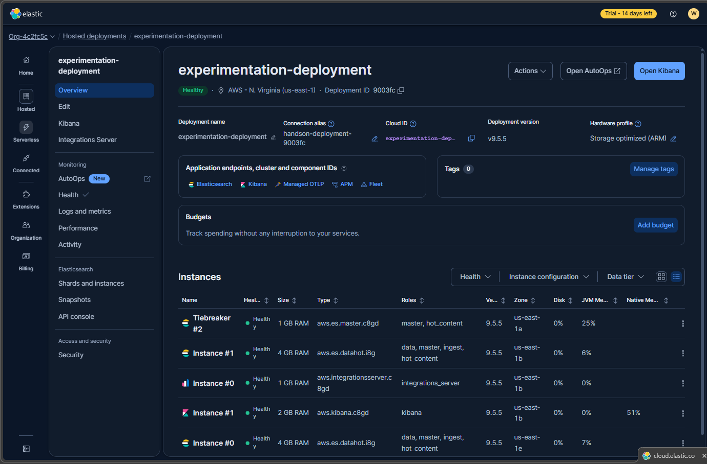
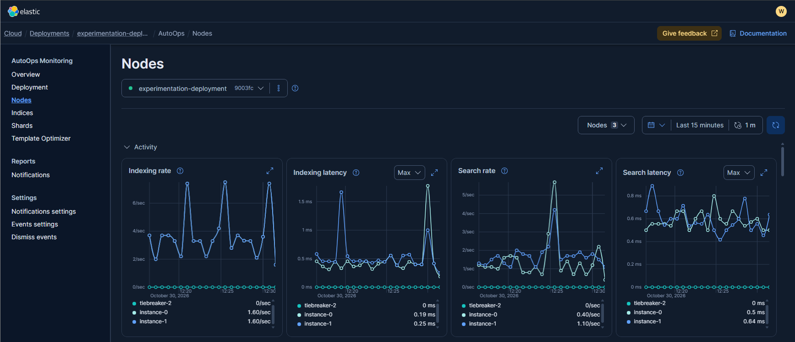
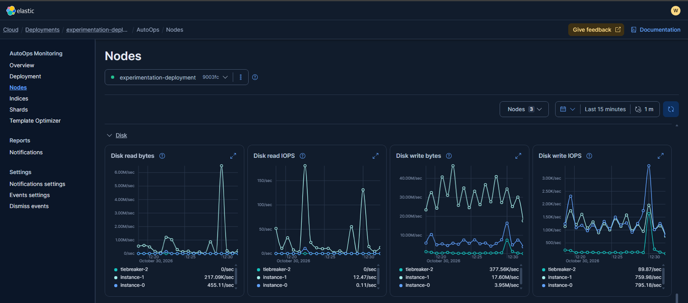
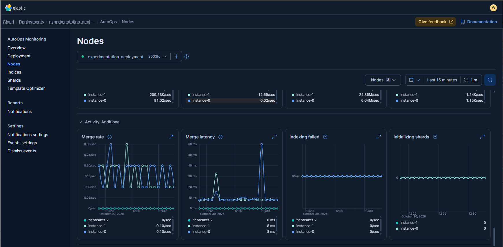
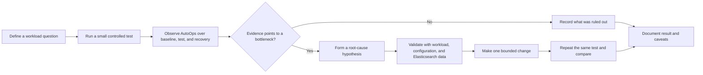

# Elastic Cloud Trial: Account, First Deployment, and AutoOps

> A practical field guide for turning an Elastic Cloud trial into a small, well-designed learning lab.
>
> **Scope:** Elastic Cloud Hosted (the managed deployment experience shown in the screenshots)  
> **Documentation checked:** 2026-10-30  
> **Important:** Trial terms, available regions, deployment options, and prices can change. Confirm the current values in your Elastic Cloud account before creating resources.

## Table of contents

- [Why this lab matters](#why-this-lab-matters)
- [What the screenshots show](#what-the-screenshots-show)
- [Create an Elastic Cloud trial account](#create-an-elastic-cloud-trial-account)
- [Trial, free features, quotas, and cost controls](#trial-free-features-quotas-and-cost-controls)
- [Explore AutoOps](#explore-autoops)
- [A useful first-lab workflow](#a-useful-first-lab-workflow)
- [Enterprise lessons to take away](#enterprise-lessons-to-take-away)
- [Before publishing screenshots](#before-publishing-screenshots)

## Why this lab matters

A trial is more useful when it is treated as a short, bounded experiment rather than a disposable demo. Make each deployment answer a question: *What operational decision can I make from this data, and what evidence would justify that decision in production?*

This folder captures the first step: creating an Elastic Cloud account and inspecting a hosted deployment with AutoOps. The notes supplied with the screenshots describe the trial as generous and call out AutoOps as a useful way to explore deployment health and performance. The sections below turn those observations into a repeatable, cost-aware learning exercise.

The source material for this entry contains screenshots and brief notes, but no shell commands, API requests, EQL, or configuration changes. None are invented here; add them to later lab entries when you capture and test them.

## What the screenshots show

The supplied screenshots capture a trial deployment named `experimentation-deployment`:

| Screenshot | What is visible | What to learn from it |
|---|---|---|
| [deployment.png](./deployment.png) | A healthy Elastic Cloud Hosted deployment, trial countdown, Elasticsearch version `9.5.5`, an AWS `us-east-1` region, deployment components, and a Budgets panel. | A deployment is a topology of separately sized components, not just “an Elasticsearch cluster.” Region, version, roles, and component sizes are operational choices. |
| [AutoOps1.png](./AutoOps1.png) | AutoOps node-level activity charts, including indexing/search rates and latency. | Rates and latency should be interpreted together and over an appropriate time window; a chart alone does not explain the workload. |
| [AutoOps2.png](./AutoOps2.png) | Additional node metrics, including disk activity, read/write IOPS, and throughput. | Resource pressure is multidimensional. Disk bytes and IOPS are different signals, and a single node may behave differently from its peers. |
| [AutoOps3.png](./AutoOps3.png) | Further node activity and additional metrics, including merge activity, indexing failures, and initializing shards. | Use the dashboard to form a hypothesis, then validate it against workload, shard layout, and Elasticsearch data. A flat chart can mean “no activity,” not necessarily “healthy under load.” |

These are point-in-time observations, not service-level guarantees. The screenshots do not establish the trial's exact resource allowance, maximum deployment count, or total cost.

## Create an Elastic Cloud trial account

1. Open the Elastic Cloud console and follow its account sign-up flow.
2. Create an account and complete the identity/email verification steps presented by Elastic.
3. Sign in to the Cloud Console and start the offered trial, if prompted. Read the current trial terms and billing requirements before accepting.
4. Create an **Elastic Cloud Hosted** deployment. Select a name, cloud provider, region, and Elastic Stack version.
5. Review the proposed topology and component sizes before creating it. Keep a note of the chosen region, version, hardware profile, and any trial expiry shown in the console.
6. Wait for the deployment to become healthy, then open Kibana and AutoOps from the deployment page.
7. Store any generated credentials in a password manager or secret store. Do not paste passwords, API keys, or endpoint credentials into this learning repository.

### Choose the first deployment intentionally

- **Region:** Select a region close to your test workload and consistent with any data-residency constraint you are learning about. Region availability and pricing differ.
- **Version:** Prefer the current supported version for new exercises. Record the exact version because behavior, APIs, and UI labels evolve.
- **Topology and size:** Start with the smallest topology that can demonstrate the concept. A lab result from a small topology is not evidence that the same configuration meets production throughput or availability targets.
- **Deployment name:** Use an unambiguous name such as `lab-eql-2026-10`, not a name that implies production.
- **Workload:** Decide what you will ingest and what question you intend to answer before adding data. Synthetic or sanitized data is usually sufficient for a learning POC.

## Trial, free features, quotas, and cost controls

### A trial is not the same thing as a permanent free tier

The deployment screenshot shows **“Trial - 14 days left”** at the time it was captured. That is evidence of this account's displayed countdown, not a guarantee that every account will receive the same duration or terms. Treat the trial as time-limited, and check its actual status in your own console.

Elastic Cloud Hosted is a paid managed service after any applicable trial or credits. Do not infer that a temporary trial allowance is a recurring free quota. The current signup flow, account billing page, and official pricing information are the authoritative places to check what applies to your account.

| Question | Safe way to establish the answer |
|---|---|
| How long is my trial, and when does it end? | Check the account/deployment banner and subscription or billing area in the Cloud Console. Record the displayed expiry date. |
| What usage or resource limits apply? | Review the plan/trial details shown for your account and the deployment configuration page. Do not use a quota remembered from an older tutorial. |
| What will this deployment cost? | Check the current pricing estimator and billing view for the selected provider, region, version, and topology before creating or resizing it. |
| Is a budget a hard spending cap? | The screenshot describes Budgets as tracking spending “without any interruption to your services.” Treat it as visibility, not as an automatic stop or guaranteed spend ceiling; confirm current budget behavior in the console. |
| What happens at trial end? | Read the current account-specific trial terms and any notifications from Elastic. Do not assume the deployment will be retained, converted, or deleted in a particular way. Export anything important and plan cleanup or conversion before the displayed deadline. |

**Cost-conscious lab habits**

1. Create only the deployment(s) needed for the exercise.
2. Capture the deployment topology and expected cost before starting a workload.
3. Use a short, controlled workload and observe whether it changes CPU, memory, disk, indexing, or search metrics.
4. Delete resources when the exercise is complete if you need to stop their ongoing usage charges. **Deletion permanently removes deployment data**, and charges already incurred before deletion can still appear on a later bill. Export anything you need first.
5. Check billing after experiments. Budgets and dashboards improve visibility, but good resource lifecycle discipline is still required.

One useful distinction: AutoOps itself is documented as free across Elastic Cloud Hosted subscription levels and does not consume Elastic Cloud Units (ECUs). That does **not** make the Elasticsearch deployment or all other services free.

## Explore AutoOps

For Elastic Cloud Hosted, AutoOps is set up automatically in supported regions. From the Cloud Console, open the deployment and choose **AutoOps** or **Open AutoOps**. If it is missing, verify regional availability and consult the current documentation rather than assuming the feature is disabled or misconfigured.

The screenshots show the **Nodes** view with a time range of **Last 15 minutes** and a refresh interval of **1 minute**. Use these as an orientation, not as recommended production alert thresholds.

### A disciplined way to read a chart

1. **Set the question first.** For example: “Did indexing slow down during this test?”
2. **Choose a useful time window.** Include a quiet baseline, the workload, and the recovery period.
3. **Compare nodes and components.** A cluster-wide average can hide a hot node or an uneven workload.
4. **Correlate signals.** Compare indexing rate with indexing latency, rejections/failures, resource use, and shard activity. For disk, compare throughput and IOPS rather than treating them as interchangeable.
5. **Check the workload and configuration.** A spike may be expected during bulk indexing; it is not automatically an incident.
6. **Write down evidence and a next step.** Record the observation, likely cause, confidence, and what you would validate next.

AutoOps is an operational insight tool, not an automatic remediation system. Current Elastic documentation describes it as read-only, focused on Elasticsearch rather than the entire Elastic Stack, with a 10-day data-retention period. It complements—not replaces—application-level telemetry, logs, longer-term monitoring, or a production incident process.

### Screenshots

**Deployment overview and topology**



**AutoOps node activity**



**AutoOps disk metrics**



**AutoOps additional node metrics**



### The operational feedback loop



## A useful first-lab workflow

Use the following as a small POC that produces evidence rather than just screenshots:

1. **Baseline:** Record deployment version, region, component topology, time range, and idle node metrics.
2. **Question:** Choose one measurable question, such as whether a controlled indexing workload increases latency or disk I/O.
3. **Test:** Use a small, non-sensitive dataset and document the workload size and duration. Avoid unbounded ingestion.
4. **Observe:** Capture the relevant AutoOps charts before, during, and after the test. Note which node(s) changed and when.
5. **Interpret:** Separate correlation from cause. For example, increased write IOPS during indexing is expected; it does not, by itself, prove disk saturation.
6. **Recommend:** State what you would investigate or change in an enterprise environment, and identify the evidence you would need before doing so.
7. **Clean up:** Remove test data or the deployment when it is no longer needed, taking care not to remove shared or valuable data.

For each experiment, save a short record:

```text
Question:
Deployment version / region / topology:
Dataset and workload:
Time window:
Observed signals:
Interpretation and confidence:
Next validation step:
Cleanup completed:
```

## Enterprise lessons to take away

- **A green health indicator is not an SLO.** Production readiness requires workload-specific service objectives, alerting, capacity planning, and tested recovery procedures.
- **Topology is a design decision.** Node roles, instance sizes, zones, and data tiers should reflect availability, performance, and cost requirements—not simply the trial's default.
- **Metrics need context.** Define normal behavior for the workload, examine outliers by node, and correlate latency with queues, failures, resource pressure, and shard distribution.
- **Operational visibility is not governance.** Enterprise deployments also need least-privilege access, credential rotation, auditability, data classification, retention policy, and ownership.
- **A POC should have an exit criterion.** Decide what success means, what is explicitly out of scope, and how the environment and test data will be removed.
- **Record reproducibility.** Keep the exact version, region, topology, workload, test window, and observations with every conclusion. A screenshot without context is weak evidence.

## Before publishing screenshots

These screenshots are useful learning evidence, but the deployment page visibly includes organization/deployment identifiers and configuration details. Before pushing the folder to a public GitHub repository, review each image and blur identifiers, account information, endpoints, email addresses, and any credentials or customer data. IDs may not be passwords, but they can expose account metadata. Never commit secrets, even in a screenshot.
