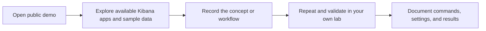

# Explore Elastic with the Ready Demo Environment

> Want to explore Kibana before creating an account or deployment? Start with Elastic's publicly available demo environment.

## Table of contents

- [Open the demo](#open-the-demo)
- [What this environment is for](#what-this-environment-is-for)
- [A practical exploration workflow](#a-practical-exploration-workflow)
- [Important limitations](#important-limitations)
- [When to move to your own deployment](#when-to-move-to-your-own-deployment)

## Open the demo

Open the [Elastic demo environment](https://demo.elastic.co/app/home#/). If the page is available, use it to explore the Kibana experience without first creating your own Elastic Cloud account or deployment.

This is a shared demo service. Its available data, applications, and access behavior can change; treat what you see as an example environment rather than a guaranteed or permanent setup.

## What this environment is for

The ready demo is useful for getting familiar with the interface and seeing how Elastic features can be presented with sample data. It can help you:

- Navigate Kibana and discover its applications.
- Explore dashboards and visualizations that are available in the demo.
- Observe how sample data is organized and displayed.
- Build familiarity before repeating a learning exercise in a deployment you control.

## A practical exploration workflow

1. Open the demo and note which applications and data are currently available.
2. Choose one question to investigate, such as what a dashboard communicates or how a data view is used.
3. Explore the UI and record the steps and concepts you can verify.
4. Separate observations from assumptions: the demo's sample data and configuration may not represent a production deployment.
5. If you need to run commands, change settings, or verify behavior, repeat the exercise in a personal lab where you control the deployment.

## Important limitations

- **Shared environment:** Other people may be using the same service. Do not expect exclusive access or stable state.
- **Changes may not persist:** Demo data, dashboards, and configuration may be reset, changed, or unavailable without notice.
- **No production evidence:** A demo cannot establish capacity, performance, availability, security posture, or service-level behavior for your own workload.
- **Avoid sensitive data:** Do not enter credentials, customer information, or other confidential data into a public demo.
- **Access may change:** If the URL or a feature is unavailable, continue with an account or deployment you control rather than assuming the service is permanently available.

## When to move to your own deployment

Use the ready demo for **orientation**. Create or use a deployment you control when you need to:

- Ingest your own test data or create indices.
- Run and retain API requests, EQL, or configuration changes.
- Confirm results are repeatable.
- Test permissions, integrations, lifecycle behavior, or operational settings.
- Measure performance or make decisions that depend on your deployment topology.

Keep the distinction clear in your notes: a screenshot from the public demo records an observed UI state; a result from your own lab records behavior under your chosen version, data, and configuration.
