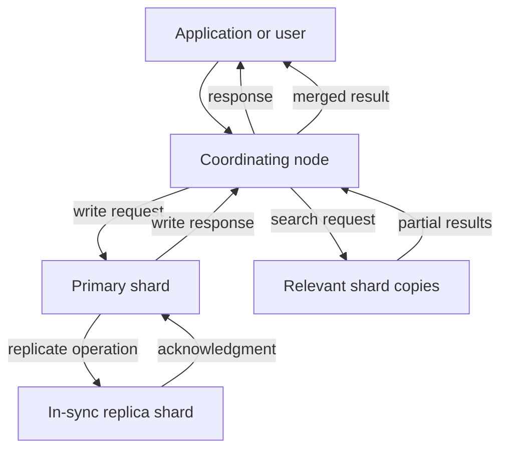
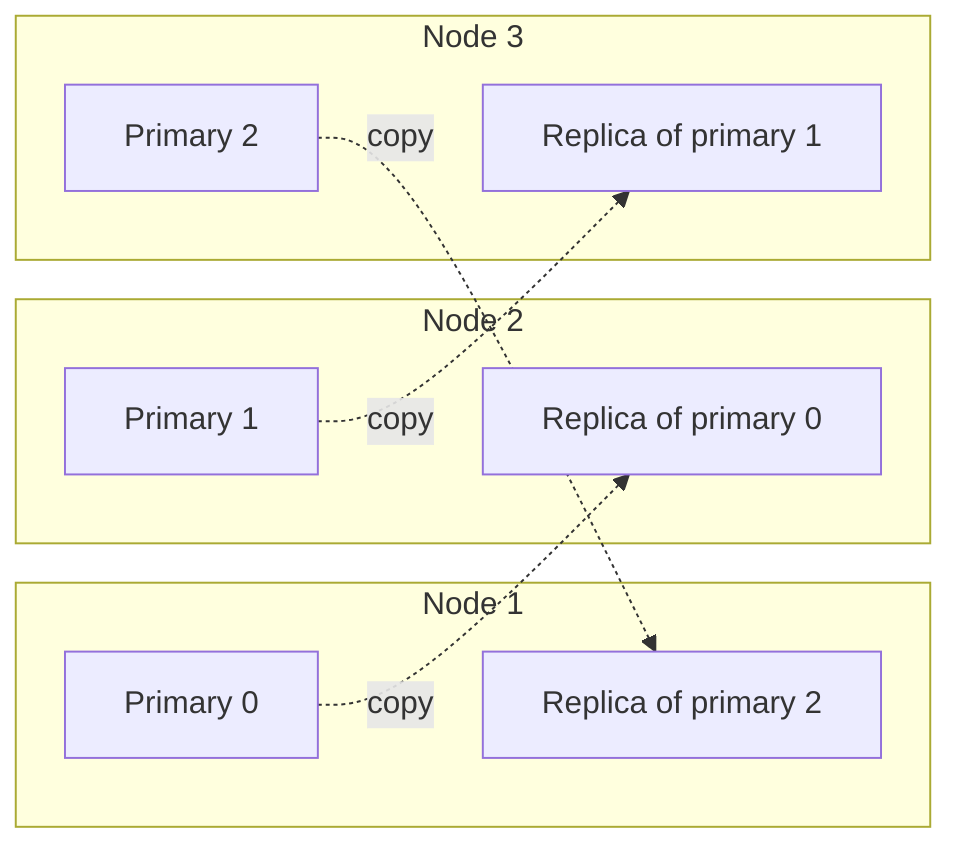

# Elasticsearch Architecture: Clusters, Nodes, and Shards

> Understand the path from a client request to distributed data—and why topology, shard design, and recovery planning belong together.

## Table of contents

- [The architecture at a glance](#the-architecture-at-a-glance)
- [Core building blocks](#core-building-blocks)
- [A shard-placement example](#a-shard-placement-example)
- [What happens during a write](#what-happens-during-a-write)
- [What happens during a search](#what-happens-during-a-search)
- [Availability, replicas, and backups](#availability-replicas-and-backups)
- [Shard design and operational trade-offs](#shard-design-and-operational-trade-offs)
- [Deployment models change the operator's role](#deployment-models-change-the-operators-role)
- [Production design questions](#production-design-questions)

## The architecture at a glance

Elasticsearch distributes a dataset by dividing indices into **shards**, then assigning shard copies to **nodes**. A client can send a request to any eligible node; that node coordinates work across the relevant shards and combines the results.

The diagram is conceptual: a real request may involve several primary shards and replica copies, and node roles can be combined or separated. It illustrates the key idea that distribution is part of request execution, not just storage.

## Core building blocks

| Concept | Meaning | Why it matters |
|---|---|---|
| **Cluster** | Elasticsearch nodes operating together under a cluster state. | Provides a shared API surface and coordinates metadata, allocation, and node membership. |
| **Node** | One running Elasticsearch instance, with configured roles and resources. | Node roles and capacity determine which work it can perform and where shards can be allocated. |
| **Index** | A logical collection of documents with mappings and settings. | Defines how documents are organized, interpreted, and divided into shards. |
| **Primary shard** | The authoritative shard copy for a partition of an index. | Each document is routed to one primary shard for indexing. |
| **Replica shard** | A copy of a primary shard, maintained as part of a replication group. | Can improve resilience and search capacity when placed on separate failure domains. |
| **Cluster state** | Shared metadata about nodes, indices, mappings, settings, and shard allocation. | Changes such as creating an index or changing settings affect cluster metadata and should be governed. |

An index with multiple primary shards spreads documents across partitions. Replicas copy those partitions; they are not extra primary partitions. Replicas must be allocated to different nodes from their corresponding primaries, so a one-node cluster cannot host a replica copy on a second machine.

### Node roles in brief

Roles describe the work a node can take on. Common roles include **master-eligible** (participates in cluster coordination), **data** (holds shards and performs data operations), **ingest** (pre-processes documents), and **coordinating-only** (routes requests and merges results without holding data or participating as master). Production designs may use dedicated roles to isolate workloads, but more node types also add operational complexity.

## A shard-placement example

Imagine one index with three primary shards and one replica per primary. Elasticsearch can distribute the six copies across three nodes so a primary and its own replica are not on the same node:

This is one illustrative allocation, not a prescribed production layout. It shows why replica count, node count, and placement interact. For resilience to a zone failure, node-level separation alone is insufficient: use an appropriate multi-zone topology and supported allocation-awareness configuration, then verify actual placement and behavior during a failure test.

## What happens during a write

For an index or update operation, Elasticsearch uses document routing—by default derived from the document ID—to identify the relevant shard group.

1. A coordinating node receives the request and routes it to the primary shard for that document.
2. The primary validates and applies the operation.
3. The primary forwards the operation to the in-sync replica copies.
4. Once the required in-sync copies have completed the operation, the primary acknowledges success to the coordinating node, which returns the response.

This replication path is why node placement and network/storage performance affect write behavior. A response is not simply “the local node wrote a document”; it reflects distributed work and acknowledgement rules.

## What happens during a search

1. A coordinating node determines which shard copies match the target index or data stream.
2. It sends search work to one suitable copy of each relevant shard group.
3. Shard copies return partial results.
4. The coordinating node merges those results, applies the requested sort/aggregation behavior, and responds to the client.

Searches fan out across shards, so excessive shard counts can increase coordination work even when the amount of data is small. A fast query on a small lab index does not prove that the same design will scale to production volume or concurrency.

## Availability, replicas, and backups

Replicas can keep data available when a node hosting a primary fails, provided a replica is available and the remaining cluster has enough capacity. They can also serve search requests. They do **not** replace snapshots:

- A mistaken delete or damaging update can be replicated.
- Replicas do not independently protect against cluster-wide loss or retention mistakes.
- A snapshot provides a recovery point, but only a tested restore demonstrates that the recovery plan works.

Availability also depends on failure-domain placement. Copies placed in the same failure domain can be lost together. Plan zones, capacity headroom, snapshot policy, and recovery objectives as one design rather than treating a replica count as a complete HA strategy.

## Shard design and operational trade-offs

| Design choice | Benefit | Cost or risk to evaluate |
|---|---|---|
| More primary shards | More partitions that can be processed in parallel. | More per-shard overhead and coordination; changing primary count later is not a simple setting update. |
| More replicas | More shard copies for resilience and potentially more search capacity. | More storage and write replication work; replicas need eligible nodes and capacity. |
| Dedicated node roles | Workload isolation and clearer resource boundaries. | More infrastructure and more complex capacity, placement, and upgrade planning. |
| Smaller/shorter-lived time-series indices | Easier retention and lifecycle management. | Poor rollover or shard sizing can still create many small shards and metadata overhead. |

- **Primary shard count** is set when an index is created. Changing it later requires a deliberate data lifecycle operation, such as reindexing or splitting/shrinking where supported.
- **Replica count** can generally be changed after creation, subject to deployment support and allocation capacity.
- **Too many small shards** consume heap and coordination resources; **too few oversized shards** can constrain parallelism and make recovery slower.
- Rollover and data-stream lifecycle policies can keep time-series indices bounded instead of creating one indefinitely growing index.
- Index design should consider expected data volume, retention, query pattern, recovery time, and growth—not just the default values in a trial wizard.

Use the official shard-sizing guidance as a starting point, then validate with representative data and workload. There is no single shard count that is optimal for every workload.

## Deployment models change the operator's role

With **self-managed Elasticsearch**, the operator is responsible for infrastructure, node roles, cluster configuration, scaling, upgrades, shard allocation, and recovery.

With **Elastic Cloud Hosted**, Elastic manages the underlying service, while operators still choose deployment topology and remain responsible for data modeling, workload design, access, retention, and recovery requirements.

With **Elastic Cloud Serverless**, much of the node and shard machinery is abstracted. The concepts remain useful for understanding performance and resilience, but the platform does not expose the same infrastructure-level controls.

## Production design questions

Before calling a design production-ready, ask:

1. What are the expected ingest rate, search concurrency, retention, and growth?
2. What are the availability and recovery objectives, and have snapshot restores been tested?
3. Can the cluster tolerate a node or zone loss while meeting the workload's SLOs?
4. Are shard sizes, mappings, and lifecycle policies appropriate for the data?
5. Who can change cluster settings, index templates, and retention—and how are those changes reviewed?
6. Which metrics or alerts indicate real user impact rather than merely a component being busy?
