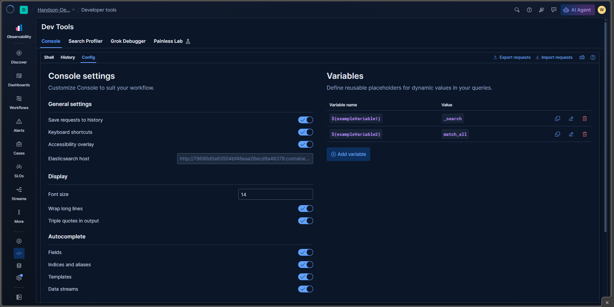

# Console Config

> Configure the Console editor and reusable request variables.

## Table of contents

- [Settings visible in the screenshot](#settings-visible-in-the-screenshot)
- [Variables](#variables)
- [Endpoint and safety](#endpoint-and-safety)
- [Screenshot](#screenshot)

## Settings visible in the screenshot

The **Config** tab includes controls for:

- Saving requests to History.
- Keyboard shortcuts and the accessibility overlay.
- Elasticsearch host.
- Font size, line wrapping, and triple quotes in output.
- Autocomplete for fields, indices and aliases, templates, and data streams.

Choose editor settings to suit your workflow. Autocomplete can speed up exploration, but suggestions are not a substitute for checking the target index, field, or API against the actual deployment.

## Variables

Console variables let you reuse values in requests. The screenshot shows example variables whose values are `search` and `match_all`. To try the request below, first define an `exampleIndex` variable and set its value to an index you own:

```http
GET /${exampleIndex}/_search
{
  "query": {
    "match_all": {}
  }
}
```

Use the placeholder syntax shown in the request and keep variable values non-sensitive: a reusable variable is not a secret store.

## Endpoint and safety

The Elasticsearch host setting determines where Console sends requests. Before running anything—especially a write or delete request—verify the host, active deployment, and request path. Changing the host can direct familiar-looking requests to a different cluster.

If you are unsure, begin with a harmless read such as `GET /` and inspect the response to confirm the cluster. Do not put credentials in the host field when a secure, supported authentication flow is available.

## Screenshot



The screenshot's Elasticsearch host is environment-specific. Redact the URL and identifiers before publishing.
