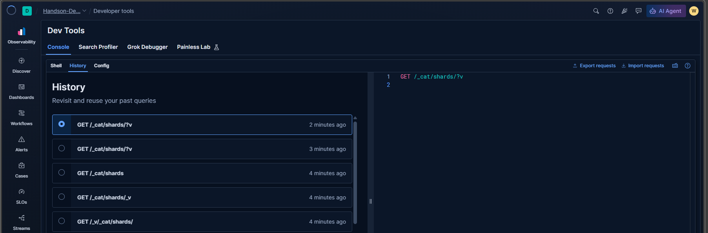

# Console History

> Use request history to revisit and reuse earlier Console work.

## Table of contents

- [What it does](#what-it-does)
- [A practical workflow](#a-practical-workflow)
- [History is not version control](#history-is-not-version-control)
- [Screenshot](#screenshot)

## What it does

The **History** tab lists prior Console requests and lets you select one to inspect or reuse. The supplied screenshot shows several variations of a CAT shards request, ordered with recent requests first.

History is helpful when exploring an API: change one parameter, compare the response, and keep the request that answers the question. The **Save requests to history** setting is available in Config; if history is not appearing, check that setting.

## A practical workflow

1. Select an earlier request and confirm its target, method, and body.
2. Copy or edit it in the Shell editor.
3. Narrow the index or query before rerunning against a larger environment.
4. Add an explanatory note when promoting a useful request into a documented lab.

## History is not version control

History is a convenience feature, not a durable or reviewed record; do not assume it is shared with teammates or retained as a project record. It is not a replacement for a Git repository, tested automation, or a change-management process. For important work, save a sanitized request in the relevant lab documentation and record what it does.

Before sharing history exports or screenshots, inspect them for secrets, internal endpoints, tenant identifiers, and sensitive query terms.

## Screenshot

