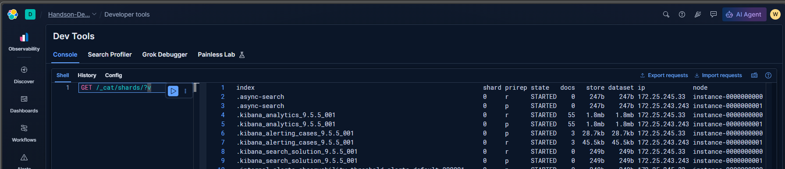

# Console Shell

> The request editor and response pane in Kibana Dev Tools → Console.

## Table of contents

- [What it does](#what-it-does)
- [Request examples](#request-examples)
- [Good habits](#good-habits)
- [Screenshot](#screenshot)

## What it does

The **Shell** tab shown in the screenshots is the Console request editor. It accepts Elasticsearch or Kibana API requests, sends them to the configured service, and displays the response. It is not a command shell for the computer.

In the supplied screenshot, the request is `GET /_cat/shards/?v`. The `GET` method reads information; the CAT shards API returns a human-readable view of shard allocation and state. CAT APIs are useful for exploration, but their output is intended for people, not as a stable machine-readable integration format.

## Request examples

Read cluster information:

```http
GET /
```

Inspect shard placement in a lab:

```http
GET /_cat/shards?v
```

Search a specific index (replace the example name with an index you own):

```http
GET logs-example/_search
{
  "size": 5,
  "query": {
    "match_all": {}
  }
}
```

Console usually lets you execute the request at the cursor with its run control or keyboard shortcut. Check the current UI/help for the shortcut rather than assuming it is the same across versions or keymaps.

## Good habits

- Keep the method, path, and JSON body together as one request.
- Use a small `size` while exploring; avoid broad queries on large or production indices.
- Prefer `_search` responses or APIs intended for automation when building integrations; do not parse CAT output as a stable contract.
- `GET` is usually read-only, but an expensive query can still affect a busy cluster. Use time ranges and filters when appropriate.
- Treat `PUT`, `POST`, and `DELETE` as potentially state-changing. Confirm the target and understand the API before execution.
- Keep secrets out of request bodies and screenshots.

## Screenshot



The screenshot contains environment-specific index names and internal node addresses. Redact those details before sharing publicly.
