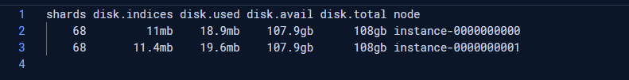
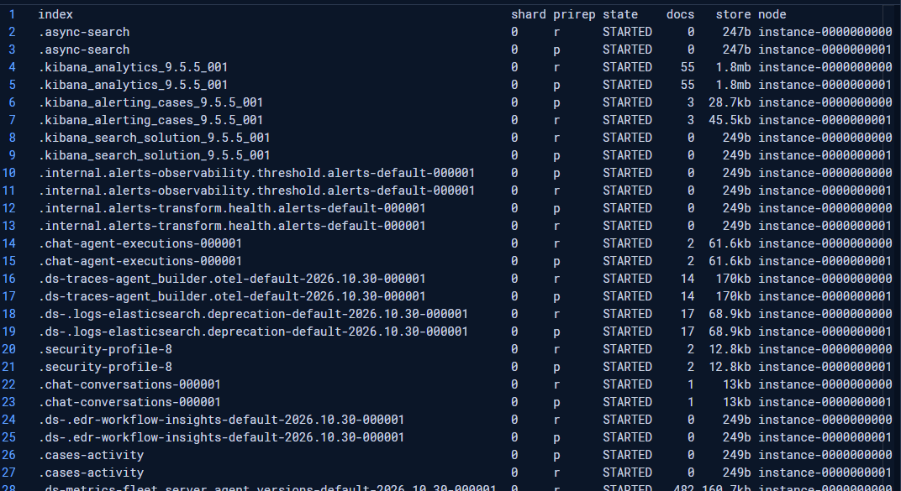
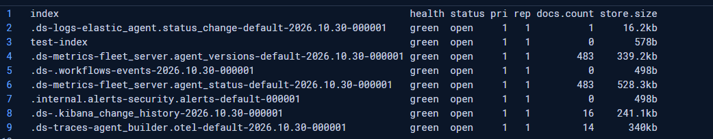
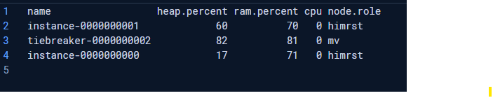
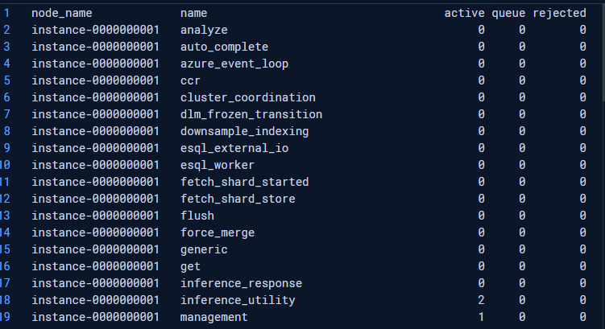
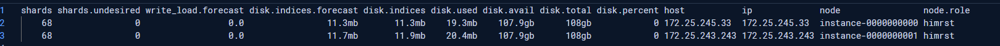
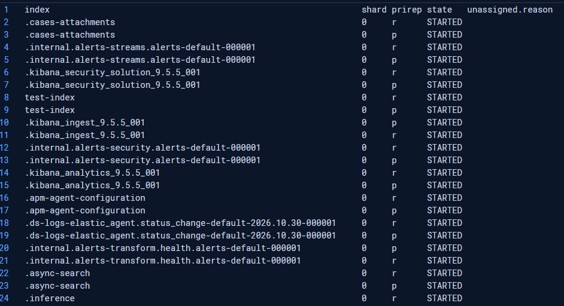
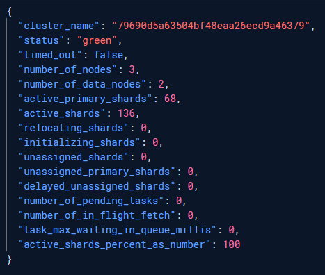
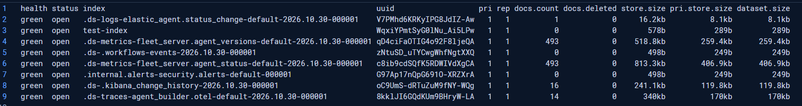
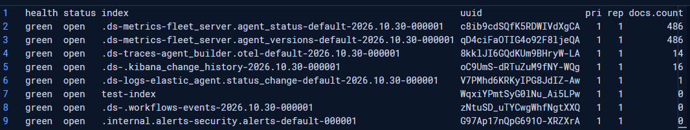

# Elasticsearch Operational Queries

These are practical CAT and cluster-health API requests for checking cluster state, node pressure, shard placement, and index footprint. They are not EQL; they are useful operational checks to run before forming a deeper troubleshooting hypothesis.

## Table of contents

- [How to use this page](#how-to-use-this-page)
- [A practical triage order](#a-practical-triage-order)
- [1. Disk and shard allocation summary](#1-disk-and-shard-allocation-summary)
- [2. Pending cluster tasks](#2-pending-cluster-tasks)
- [3. Shard placement details](#3-shard-placement-details)
- [4. Index health and size summary](#4-index-health-and-size-summary)
- [5. Node resource snapshot](#5-node-resource-snapshot)
- [6. Thread-pool queue and rejections](#6-thread-pool-queue-and-rejections)
- [7. Full allocation view](#7-full-allocation-view)
- [8. Shards with allocation reasons](#8-shards-with-allocation-reasons)
- [9. Cluster health](#9-cluster-health)
- [10. Full index view](#10-full-index-view)
- [11. Largest indices first](#11-largest-indices-first)
- [Further administration examples](#further-administration-examples)
- [Before publishing screenshots](#before-publishing-screenshots)

## How to use this page

Run these requests in **Kibana → Dev Tools → Console** against the deployment you intend to inspect. CAT APIs are designed for human-readable output; for scripts and integrations, prefer stable JSON APIs and handle their response structure explicitly.

Treat a single response as a snapshot, not a diagnosis. Compare results over time, correlate related signals, and check the workload and recent changes before concluding that a metric indicates a problem. The screenshots are examples from one lab deployment, not production baselines or recommended thresholds.

## A practical triage order

1. Check overall status with **cluster health**.
2. Look for cluster-state work waiting in **pending tasks**.
3. Check **nodes** and **thread pools** for resource pressure or request backlogs.
4. Inspect **allocation** and **shards** for uneven placement or unavailable copies.
5. Review **indices** to understand data volume, shard counts, and likely storage contributors.

This order moves from broad symptoms toward likely contributing areas. It is a starting point, not a substitute for application SLOs and workload context.

## 1. Disk and shard allocation summary

```http
GET /_cat/allocation?v&h=shards,disk.indices,disk.used,disk.avail,disk.total,node
```

**Scenario:** You want a compact, per-node view of shard counts and disk consumption while investigating an imbalance or planning capacity.

`shards` gives a quick allocation count; `disk.indices` estimates space used by shard data on that node, while `disk.used`, `disk.avail`, and `disk.total` provide host-level disk context. Compare nodes with one another and with their capacity. A high shard count alone does not prove a node is overloaded, and free space alone does not establish that the cluster can safely allocate more shards.



## 2. Pending cluster tasks

```http
GET /_cat/pending_tasks?v
```

**Scenario:** A cluster change—such as creating an index, updating settings, or reallocating shards—appears slow or has not taken effect.

This view shows cluster-state tasks waiting to be processed, including their priority and time in queue. A growing or long-waiting queue can point to coordination pressure or a cluster-state update bottleneck. An empty response only means there are no pending tasks at that instant; it does not mean every indexing or search thread pool is idle.

No screenshot was supplied for this request. Capture one during a lab exercise where a pending task is visible, if you want to document the output.

## 3. Shard placement details

```http
GET /_cat/shards?v&h=index,shard,prirep,state,docs,store,node
```

**Scenario:** You need to see which node holds each primary (`p`) or replica (`r`) copy and whether the copy is started.

Use the output to investigate shard distribution, primary/replica placement, and the approximate documents and store size per shard. For a healthy multi-node design, a primary and its replica should not be allocated to the same node. A large index may have many rows, so narrow the output by choosing columns or sorting for the question at hand.



## 4. Index health and size summary

```http
GET /_cat/indices?v&h=index,health,status,pri,rep,docs.count,store.size
```

**Scenario:** You want an at-a-glance inventory of indices, health, shard counts, document counts, and total store size.

`pri` and `rep` are the configured primary and replica shard counts; `docs.count` is a document-count snapshot, and `store.size` includes the index's stored shard copies. This is useful for spotting unexpectedly large indices or an index whose health differs from the rest. The concise `h` list keeps the output focused; it does not include every index statistic.



## 5. Node resource snapshot

```http
GET /_cat/nodes?v&h=name,heap.percent,ram.percent,cpu,load,node.role
```

**Scenario:** Search or indexing latency has changed and you need a quick comparison of node resource signals.

Compare heap, RAM, CPU, and load across nodes rather than interpreting one number in isolation. `node.role` abbreviations identify the roles assigned to each node; the codes can be compact and version-dependent, so consult the CAT nodes documentation when decoding them. A one-time reading is not a trend: repeat the check during representative workload and correlate it with latency, queues, and allocation.



## 6. Thread-pool queue and rejections

```http
GET /_cat/thread_pool?v
```

**Scenario:** Requests are slowing down, timing out, or being rejected, and you want to check whether Elasticsearch work queues are backing up.

Review thread-pool `active`, `queue`, and `rejected` values. A sustained non-zero queue or increasing rejections for a relevant pool can indicate that work is arriving faster than the node can process it. Rejection counts are counters, so compare repeated samples to see whether they are increasing; a non-zero historical total by itself does not prove current pressure.

Use the output to choose a direction for investigation, not to immediately increase queue sizes. Larger queues can hold more waiting work and consume memory without fixing an overloaded workload.



## 7. Full allocation view

```http
GET /_cat/allocation?v
```

**Scenario:** You need more detail than the compact allocation view provides, such as a broad per-node picture while investigating balance or disk pressure.

The default CAT allocation output includes additional columns, such as shard-related figures, disk percentages, and node/host information. It is useful for exploratory troubleshooting; the output is wide and can be harder to compare. For a repeatable report, choose a small set of explicit columns as in query 1.

Disk watermarks and allocation decisions depend on Elasticsearch settings and current cluster conditions. Do not infer that a node is safe to receive shards from a single disk percentage; verify the relevant thresholds, forecast, and allocation explanation.



## 8. Shards with allocation reasons

```http
GET /_cat/shards?v&h=index,shard,prirep,state,unassigned.reason
```

**Scenario:** You are checking for unassigned shard copies and want the reason field in the listing.

Rows with an unassigned state can include an `unassigned.reason` value that helps identify the event associated with the shard becoming unassigned. The supplied screenshot shows started shards, so the reason column is blank; that is expected and does not indicate a hidden allocation failure.

For a specific unassigned shard, use the Cluster Allocation Explain API to ask Elasticsearch why it cannot be allocated and what deciders are preventing allocation. Do not treat the reason field alone as a complete remediation plan.



## 9. Cluster health

```http
GET /_cluster/health
```

**Scenario:** Start here when you need an overall snapshot of whether shard copies are allocated and whether the cluster is processing recovery or relocation work.

The response includes status, node counts, active and unassigned shard counts, and related health fields. In broad terms, **green** means all primary and replica shards are allocated; **yellow** means primaries are allocated but at least one replica is not; **red** means at least one primary is unallocated. Investigate the detailed shard and allocation output to understand why.

The screenshot shows green status, zero unassigned shards, and no relocating or initializing shards at that moment. Health status is not a service-level objective: a green cluster can still have high latency, a failing ingest pipeline, or an application-facing outage.



## 10. Full index view

```http
GET /_cat/indices?v
```

**Scenario:** You need a broader inventory during an investigation and want to inspect columns not included in the concise query 4.

The default view can show health, status, index name, UUID, primary and replica counts, document statistics, and storage measurements. Use it to identify candidates for closer inspection, then narrow the output or query a specific index. `store.size` and primary-store measurements answer different questions; account for replicas when estimating total cluster storage.

For recurring operations, prefer an explicit header list or a JSON API to avoid relying on default columns that may change.



## 11. Largest indices first

```http
GET /_cat/indices?v&s=store.size:desc
```

**Scenario:** You need to find which indices account for the largest stored footprint before investigating retention, rollover, or capacity.

Sorting by `store.size` puts the largest index totals at the top. Treat this as a prioritization aid: the biggest index is not automatically the cause of a disk problem, and index size alone says nothing about growth rate or business retention requirements. Compare the result with data lifecycle policy and primary-store size when deciding what to investigate.



## Further administration examples

For scoped examples covering health reports, node/task diagnostics, index lifecycle, slow-log configuration, snapshots, security inventory, and shard rerouting, see [Elasticsearch Administration: Diagnostic and Change APIs](./Few_queries.md). That companion guide also consolidates duplicate requests from the original notes and flags destructive or potentially disruptive operations.

## Before publishing screenshots

The images show deployment-specific index names, node names, internal IP addresses, and cluster identifiers. Redact those details before publishing the repository publicly, especially if any names or identifiers reveal organization or customer information.
