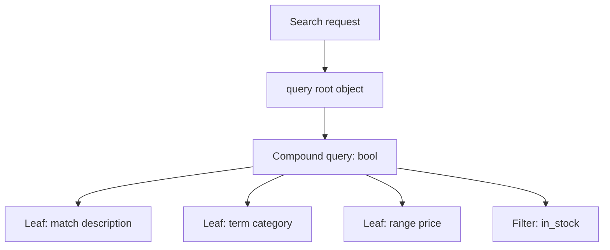
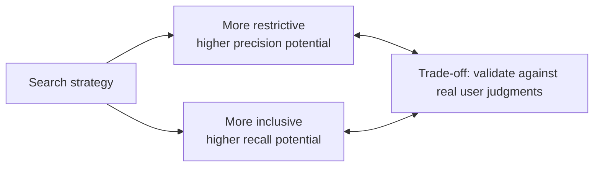

# Searching in Elasticsearch: Query DSL and Relevance

> A search query is a set of choices: what must match, what may match, what must be excluded, and whether relevance or exactness matters most.

## Table of contents

- [What is the Query DSL?](#what-is-the-query-dsl)
- [Leaf and compound queries](#leaf-and-compound-queries)
- [Full-text, exact-term, and range queries](#full-text-exact-term-and-range-queries)
- [Combining conditions with bool](#combining-conditions-with-bool)
- [Relevance scores and ranking](#relevance-scores-and-ranking)
- [Precision and recall](#precision-and-recall)
- [Controlling optional matches](#controlling-optional-matches)
- [Aggregations](#aggregations)
- [A practical search example](#a-practical-search-example)

## What is the Query DSL?

Elasticsearch's Query DSL (Domain Specific Language) is a JSON-based way to describe searches. A search request can include a `query` root object, which contains one or more query clauses. The clause describes what documents to find; additional request options can control sorting, pagination, returned fields, and aggregations.

```http
GET /electronics_store/_search
{
  "query": {
    "match": {
      "description": "wireless headphones"
    }
  }
}
```

In this example, `query` is the query root object and `match` is the query clause. The DSL is composable: a simple clause can be used alone or placed inside a compound query.

## Leaf and compound queries

**Leaf queries** search for a particular value or condition. Common examples include:

- `match` for analyzed full-text search.
- `term` for an exact indexed value.
- `range` for values within a numeric or date interval.

**Compound queries** combine other queries. The `bool` query is the most commonly used compound query; it combines conditions using required, optional, excluded, and non-scoring filter clauses.



Think of the compound query as the structure of the decision and the leaf queries as its individual tests. This makes complex searches easier to build and troubleshoot incrementally.

## Full-text, exact-term, and range queries

Choose a query based on the mapping and the intended meaning:

| Query | Best suited for | Example field |
|---|---|---|
| `match` | Words or phrases in analyzed text; the input is analyzed before searching. | `description` (`text`) |
| `term` | Exact indexed values; the query value is not analyzed like full text. | `category` (`keyword`), `in_stock` (`boolean`) |
| `range` | Values between bounds, such as prices or dates. | `price` (`double`), `created_at` (`date`) |

Full-text example:

```json
{
  "match": {
    "description": "wireless headphones"
  }
}
```

Exact-value example:

```json
{
  "term": {
    "category": "audio"
  }
}
```

Range example:

```json
{
  "range": {
    "price": {
      "gte": 50,
      "lt": 200
    }
  }
}
```

The range above includes 50 and excludes 200. A frequent source of unexpected results is using `term` on an analyzed `text` field, or using `match` where an exact identifier or category value is required. Check the field mapping when results look surprising.

## Combining conditions with bool

The `bool` query combines clauses with four operators:

| Clause | Meaning | Scoring behavior |
|---|---|---|
| `must` | The document must match this clause. | Contributes to `_score`. |
| `should` | The document may match this clause; matching can improve relevance. | Contributes to `_score`. |
| `must_not` | The document must not match this clause. | Excludes documents; does not contribute to score. |
| `filter` | The document must match this condition. | Does not contribute to score; useful for exact constraints and ranges. |

Example: find audio products that are in stock and under $200, rank text matches higher, and exclude discontinued products.

```http
GET /electronics_store/_search
{
  "query": {
    "bool": {
      "must": [
        {
          "match": {
            "description": "wireless headphones"
          }
        }
      ],
      "should": [
        {
          "match": {
            "brand": "Acme"
          }
        }
      ],
      "must_not": [
        {
          "term": {
            "status": "discontinued"
          }
        }
      ],
      "filter": [
        {
          "term": {
            "in_stock": true
          }
        },
        {
          "range": {
            "price": {
              "lt": 200
            }
          }
        }
      ]
    }
  }
}
```

The required text match and filters determine eligibility. The optional brand match can raise the score for matching products, but does not normally exclude products that lack that brand match. Filters are a good fit for constraints that should not affect textual relevance.

## Relevance scores and ranking

Scored queries can return a numerical `_score` for each hit. A higher score means Elasticsearch considers that result more relevant to the query than lower-scoring results; it is not a probability or a universal measure of quality.

Elasticsearch's default similarity is BM25. In broad terms, relevance depends on factors including:

- **Term frequency (TF):** how often a query term appears in a document. More occurrences can increase relevance, with diminishing returns.
- **Inverse document frequency (IDF):** how rare a term is across the searched documents. A rare, informative term often contributes more than a very common term.
- **Field-length normalization:** a term appearing in a shorter field may be more significant than the same count in a much longer field.

The source notes refer to term frequency as “density” and inverse document frequency as “rarity.” These are useful intuitions, but BM25 combines multiple factors rather than using a simple count or a raw TF × IDF formula.

Clauses in `must` and `should` can affect scoring. `filter` and `must_not` are for matching/exclusion and do not add relevance score. A request using only filters may return a constant score for matching documents, so use explicit sorting if the order should be based on a field such as price or date.

## Precision and recall

- **Precision:** of the documents returned, how many are relevant?
- **Recall:** of all relevant documents, how many did the search return?

Narrowing the query with more required conditions often improves precision but can miss relevant documents, reducing recall. Loosening conditions or allowing more alternatives can improve recall but may also return irrelevant results. The right balance depends on the use case: a compliance lookup may prioritize precision, while exploratory discovery may prioritize recall.



These are tendencies, not guarantees. Measure search quality with representative queries and judged results instead of assuming that a more restrictive or inclusive query is automatically better.

## Controlling optional matches

`minimum_should_match` sets how many `should` clauses must match. It is useful when a query contains several alternatives and matching just one is too broad.

```json
{
  "bool": {
    "should": [
      { "match": { "description": "wireless" } },
      { "match": { "description": "noise cancelling" } },
      { "match": { "description": "headphones" } }
    ],
    "minimum_should_match": 2
  }
}
```

Here, a document must match at least two of the three optional clauses. A percentage can also be used, for example `"minimum_should_match": "75%"`.

The default matters: when a `bool` query has one or more `should` clauses and no `must` or `filter` clauses, at least one `should` clause is required by default. When `must` or `filter` is present, `should` clauses are optional by default. Set `minimum_should_match` explicitly when the desired behavior is important to the search.

Treating more `should` alternatives as a broad OR can increase recall; requiring more alternatives to match can increase precision while lowering recall. `minimum_should_match` is a threshold over clauses, not a general switch between OR and AND. Tune it with test queries and expected result sets.

## Aggregations

Aggregations summarize matching documents, for example by counting products per category or calculating an average price. They can be returned with search hits or used without hits.

```http
GET /electronics_store/_search
{
  "size": 0,
  "query": {
    "term": {
      "in_stock": true
    }
  },
  "aggs": {
    "products_per_category": {
      "terms": {
        "field": "category"
      }
    },
    "average_price": {
      "avg": {
        "field": "price"
      }
    }
  }
}
```

`size: 0` omits individual hits when only the summary is needed. Terms aggregations generally require a `keyword` field rather than analyzed `text`; for text with a keyword subfield, aggregate on that subfield (for example, `category.keyword`) if that is how the mapping is defined. Be deliberate with high-cardinality fields, because large bucket counts can consume significant resources.

## A practical search example

This request combines the concepts: match analyzed product text, require stock and price constraints, exclude discontinued items, optionally boost a preferred brand, and summarize the matching products by category.

```http
GET /electronics_store/_search
{
  "size": 10,
  "query": {
    "bool": {
      "must": [
        {
          "match": {
            "description": "wireless headphones"
          }
        }
      ],
      "should": [
        {
          "term": {
            "brand": "Acme"
          }
        }
      ],
      "must_not": [
        {
          "term": {
            "status": "discontinued"
          }
        }
      ],
      "filter": [
        {
          "term": {
            "in_stock": true
          }
        },
        {
          "range": {
            "price": {
              "lte": 200
            }
          }
        }
      ]
    }
  },
  "aggs": {
    "categories": {
      "terms": {
        "field": "category"
      }
    }
  }
}
```

The exact field names and mappings must match the index. Before tuning relevance, verify the mapping, test representative queries, inspect returned fields and scores, and decide whether each condition is a ranking signal (`must`/`should`) or a hard constraint (`filter`/`must_not`).
