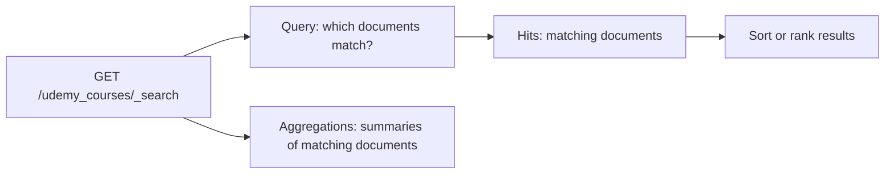

# Searching Course Data with the Elasticsearch Search API

> These examples use the `udemy_courses` index to build searches from a broad inspection to focused, filtered results and summaries.

## Table of contents

- [The Search API](#the-search-api)
- [Return all documents](#return-all-documents)
- [Match analyzed text](#match-analyzed-text)
- [Control how terms match](#control-how-terms-match)
- [Search across multiple fields](#search-across-multiple-fields)
- [Control the number of hits](#control-the-number-of-hits)
- [Combine conditions with bool](#combine-conditions-with-bool)
- [Use range and exclusion conditions](#use-range-and-exclusion-conditions)
- [Summarize results with an aggregation](#summarize-results-with-an-aggregation)
- [Operational checklist](#operational-checklist)

## The Search API

The examples use the Elasticsearch Search API:

```http
GET /udemy_courses/_search
```

The index name selects the data to search. The optional JSON request body contains a Query DSL `query`, result options such as `size`, and optionally `aggs` for summaries. A search returns hits (matching documents and metadata such as `_id` and `_score`) and, when requested, aggregation results.



## Return all documents

Use `match_all` to match every document visible to the search:

```http
GET /udemy_courses/_search
{
  "query": {
    "match_all": {}
  }
}
```

This is useful for checking that an index contains searchable documents or for inspecting a sample. It does not return every document in a large index in one response; the default page size is limited. Use pagination or a scan-oriented workflow such as the Scroll or Point in Time APIs for large-scale retrieval, rather than trying to increase `size` without limit.

## Match analyzed text

The `match` query is intended for full-text search. Elasticsearch analyzes the query text and compares its terms with the analyzed field:

```http
GET /udemy_courses/_search
{
  "query": {
    "match": {
      "course_title": "python programming"
    }
  }
}
```

By default, the terms in a `match` query are combined with OR-like behavior: a document may match one or more analyzed terms. Matching documents are scored and ranked for relevance.

The notes also search `level` with `match`:

```json
{
  "match": {
    "level": {
      "query": "Intermediate Level"
    }
  }
}
```

This is appropriate if `level` is mapped as analyzed `text` and token-based matching is desired. If the requirement is to match the complete level value exactly, use a `term` query on a `keyword` field (often a `.keyword` multi-field). Check the mapping before choosing.

## Control how terms match

To require all analyzed terms from the query string, set the `operator` to `and`:

```http
GET /udemy_courses/_search
{
  "query": {
    "match": {
      "course_title": {
        "query": "python programming",
        "operator": "and"
      }
    }
  }
}
```

This is stricter than the default OR-like behavior: both terms must match for a document to qualify. It can improve precision for some searches, but may lower recall when a relevant document contains only one of the terms.

For more flexible control, `minimum_should_match` sets a minimum number or proportion of analyzed query terms that must match:

```http
GET /udemy_courses/_search
{
  "query": {
    "match": {
      "course_title": {
        "query": "Python programming language",
        "minimum_should_match": 2
      }
    }
  }
}
```

Here, at least two analyzed terms must match. This parameter is different from the `minimum_should_match` option on a `bool` query: here it applies to terms generated by the `match` query.

## Search across multiple fields

Use `multi_match` when the same text should be searched across several fields:

```http
GET /udemy_courses/_search
{
  "query": {
    "multi_match": {
      "query": "business",
      "fields": ["subject", "course_title"]
    }
  }
}
```

This searches for `business` in both `subject` and `course_title`. The default multi-match type is `best_fields`, which generally scores a document based on its best-matching field. Use the `fields` list deliberately: searching more fields can increase recall, but may return less focused results and alter scoring.

Field boosts can prioritize one field over another. For example, `"course_title^2"` gives title matches a higher boost than an unboosted field:

```json
{
  "multi_match": {
    "query": "business",
    "fields": ["course_title^2", "subject"]
  }
}
```

## Control the number of hits

The `size` option sets the maximum number of hits returned in the response:

```http
GET /udemy_courses/_search
{
  "size": 30,
  "query": {
    "match": {
      "course_title": "Investment Banking"
    }
  }
}
```

The request asks for up to 30 matching courses. `size` does not change which documents match; it changes how many hits are returned. The default is 10. Large `size` values increase response and memory costs, and deep `from`/`size` pagination is bounded by the index's `index.max_result_window` setting. For deep pagination, use `search_after` with a stable sort; for exporting large result sets, consider Scroll or Point in Time with `search_after`, depending on the use case.

## Combine conditions with bool

Use a `bool` query to combine relevance conditions and exact constraints. This example searches course titles, then filters to a subject, paid courses, and an intermediate level:

```http
GET /udemy_courses/_search
{
  "query": {
    "bool": {
      "must": [
        {
          "match": {
            "course_title": "investment banking"
          }
        }
      ],
      "filter": [
        {
          "term": {
            "subject": "Business Finance"
          }
        },
        {
          "term": {
            "is_paid": true
          }
        },
        {
          "term": {
            "level": "Intermediate Level"
          }
        }
      ]
    }
  }
}
```

- `must` requires a match and contributes to relevance scoring. Use it for the full-text title search.
- `filter` requires a match but does not affect `_score`. It is appropriate for constraints such as category, paid status, and level.
- `term` checks an exact indexed value; it does not analyze the input text like `match`.

The exact `term` filters only work as intended when their fields and values match the index mapping. For example, `is_paid` should be mapped as `boolean` for the JSON boolean `true`; exact text values usually need a `keyword` field. If `subject` or `level` is mapped as `text` with a keyword subfield, use the appropriate exact-value field, such as `subject.keyword`.

The source notes use the misspelling `investiment` in one title query. The example below corrects it to `investment`:

```json
{
  "match": {
    "course_title": "investment banking"
  }
}
```

## Use range and exclusion conditions

`range` selects values using inclusive or exclusive boundaries. The following query finds courses with a title match, price at or below 100, and excludes beginner-level courses:

```http
GET /udemy_courses/_search
{
  "query": {
    "bool": {
      "must": [
        {
          "match": {
            "course_title": "investment banking"
          }
        }
      ],
      "filter": [
        {
          "range": {
            "price": {
              "lte": 100
            }
          }
        }
      ],
      "must_not": [
        {
          "term": {
            "level": "Beginner Level"
          }
        }
      ]
    }
  }
}
```

Range operators include `gt` (greater than), `gte` (greater than or equal), `lt` (less than), and `lte` (less than or equal). A numeric range expects a numeric mapping; dates can also be queried with ranges using date-formatted values.

`must_not` excludes documents matching the clause and does not contribute to score. As with other exact `term` clauses, confirm that `level` is a `keyword` field or change the field reference to the correct keyword subfield.

## Summarize results with an aggregation

Aggregations compute summaries over documents matching the query. A terms aggregation groups documents by distinct field values and returns a bucket per value:

```http
GET /udemy_courses/_search
{
  "size": 0,
  "aggs": {
    "popular_topics": {
      "terms": {
        "field": "subject"
      }
    }
  }
}
```

- `aggs` (also accepted as `aggregations`) defines one or more aggregations.
- `popular_topics` is a user-chosen aggregation name, used to identify its results in the response.
- `terms` creates buckets for the field's values; each bucket includes a document count.
- `size: 0` suppresses individual hits when only the summary is needed.

Terms aggregations usually need a `keyword` field (or another suitable non-analyzed field). If `subject` is mapped as `text` with a keyword subfield, aggregate on `subject.keyword`. For high-cardinality fields, consider bucket limits and resource consumption; a terms aggregation is not an unlimited export of every distinct value.

To summarize only a subset, add a query alongside `aggs`. The aggregation then summarizes documents matching that query.

## Operational checklist

- Inspect the index mapping before selecting `match`, `term`, `range`, or aggregation fields.
- Use `match` for analyzed text; use `term` for exact values on suitable fields.
- Put relevance-bearing text clauses in `must` and non-scoring constraints in `filter`.
- Choose OR-like matching, `operator: "and"`, or `minimum_should_match` based on expected recall and precision.
- Use `size` for a page of results, not as an unbounded data extraction mechanism.
- Use `size: 0` when the response only needs aggregation results.
- Validate the query against representative documents and inspect both `hits` and aggregation buckets.
