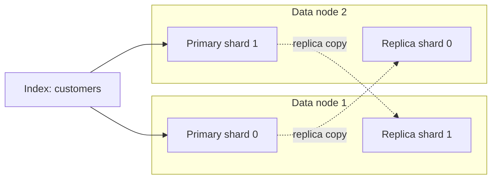

# Elasticsearch Indices: Mapping, Settings, and Shard Design

> An index is more than a place to store documents: its mapping and shard settings influence how data is searched, scaled, retained, and recovered.

## Table of contents

- [What is an index?](#what-is-an-index)
- [Index, shards, and nodes](#index-shards-and-nodes)
- [Mappings: the data structure](#mappings-the-data-structure)
- [Settings: how the index operates](#settings-how-the-index-operates)
- [Primary and replica shards](#primary-and-replica-shards)
- [Write and search visibility](#write-and-search-visibility)
- [Static and dynamic settings](#static-and-dynamic-settings)
- [Create and inspect an index](#create-and-inspect-an-index)
- [Update settings](#update-settings)
- [Index creation do's and don'ts](#index-creation-dos-and-donts)

## What is an index?

An Elasticsearch **index** is a logical collection of documents that share a mapping and index-level settings. It is the usual target for indexing and search requests. For example, an application might store customer records in a `customers` index and product records in an `electronics_store` index.

An index is logical—not one file or one server. Elasticsearch divides its data into shards and distributes shard copies across eligible nodes in the cluster. This lets searches and indexing be distributed, but it also means that index design affects resource use and availability.

## Index, shards, and nodes



This example has two primary shards and one replica per primary. Each document is routed to one primary shard; the replica is a copy of that primary's data. Elasticsearch allocates shard copies to nodes, and a primary and its own replica cannot be placed on the same node.

The drawing is conceptual. Actual placement depends on node roles, available capacity, allocation rules, and failure-domain configuration. In a multi-zone production design, plan placement across zones—not just across node names.

## Mappings: the data structure

A **mapping** defines how Elasticsearch interprets fields and indexes their values. Field types matter because they determine which operations are supported and how data is stored.

Example mapping for customer records:

```http
PUT /customers
{
  "mappings": {
    "properties": {
      "customer_id": {
        "type": "keyword"
      },
      "name": {
        "type": "text",
        "fields": {
          "keyword": {
            "type": "keyword"
          }
        }
      },
      "email": {
        "type": "keyword"
      },
      "created_at": {
        "type": "date"
      },
      "lifetime_value": {
        "type": "double"
      },
      "active": {
        "type": "boolean"
      }
    }
  }
}
```

- `text` is for analyzed full-text search.
- `keyword` is for exact matching, sorting, and aggregations.
- Numeric types such as `long` and `double` support numeric range and metric operations.
- `date` provides date-aware parsing and range queries.
- `boolean` represents true/false values.

Dynamic mapping can infer new field types from incoming documents, which is convenient for exploration. For production data, explicitly map fields whose type or query behavior matters. A mapping mistake can be difficult to correct: many field types cannot be changed in place, so correction may require a new index and reindexing. Keep dynamic fields controlled to reduce mapping explosion.

Inspect the mapping:

```http
GET /customers/_mapping
```

## Settings: how the index operates

Index settings control how Elasticsearch creates, stores, refreshes, and allocates an index. They affect performance, scalability, availability, and storage consumption.

Common settings include:

| Setting | What it controls | Operational consideration |
|---|---|---|
| `index.number_of_shards` | Number of primary shards created for the index. | Set at index creation; influences parallelism, per-shard overhead, and later flexibility. |
| `index.number_of_replicas` | Number of replica copies per primary shard. | Can be changed dynamically; increases storage and write replication work, and requires eligible nodes for allocation. |
| `index.refresh_interval` | How frequently recent changes become searchable through search. | Shorter intervals can improve visibility latency but may increase indexing overhead. |
| Allocation settings | Where shard copies are allowed or preferred. | Must align with node attributes, capacity, and failure domains; restrictive rules can leave shards unassigned. |

Settings are not a substitute for workload testing. The same index design can behave differently under different document sizes, ingest rates, query patterns, retention periods, and hardware profiles.

## Primary and replica shards

If an index has **P** primary shards and **R** replicas per primary:

- Total shard copies = `P × (1 + R)`.
- Example: 2 primaries and 1 replica produce 4 shard copies.
- Example: 2 primaries and 2 replicas produce 6 shard copies.

Primaries partition the index's documents. Replicas duplicate those partitions; they are not extra unique data partitions. Replicas can provide redundancy when placed on separate failure domains and can serve search requests, but they consume storage and add replication work to writes.

If there are not enough eligible nodes, replica shards may remain unassigned and the index/cluster can be yellow. Adding replicas is not automatically “more available”: check that placement is possible, that the surviving nodes have capacity, and that your topology meets the intended failure objective. Replicas are also not backups; accidental deletes or corrupt updates can be replicated.

Primary shard count is fixed when an index is created. Replica count can generally be changed later. Choose primary count based on expected data volume and workload, then validate shard size and query/ingest behavior rather than choosing an arbitrary high count.

## Write and search visibility

For an index operation, Elasticsearch routes a document to a primary shard, which processes the write and replicates it to in-sync copies. The request response confirms the write operation was accepted according to the replication/acknowledgment behavior; search visibility is a separate concern.

Elasticsearch is **near-real-time**. A refresh opens newly written segments for search. By default, active indices are refreshed periodically (typically about once per second after recent search activity), so a successful write may not appear in `_search` immediately. A direct GET by document ID can see an acknowledged write before it is visible to search.

Avoid forcing an immediate refresh after every write in a production workload. If a small lab needs to wait for search visibility, APIs support refresh options such as `refresh=wait_for`; use them deliberately because refresh behavior affects throughput.

## Static and dynamic settings

“Static” and “dynamic” describe **settings**, not types of shards:

- **Static settings** generally must be configured before the index is created or require a close/reopen or other controlled procedure to change.
- **Dynamic settings** can be changed on an open index while it is running, when the particular setting supports it.

For index design, `index.number_of_shards` is set at creation, whereas `index.number_of_replicas` is dynamically adjustable. Always verify the current setting documentation and deployment support before making a change; not every setting is dynamically updateable.

## Create and inspect an index

The notes proposed creating `customers` with one primary and two replicas:

```http
PUT /customers
{
  "settings": {
    "index.number_of_shards": 1,
    "index.number_of_replicas": 2
  },
  "mappings": {
    "properties": {
      "customer_id": {
        "type": "keyword"
      },
      "name": {
        "type": "text"
      },
      "created_at": {
        "type": "date"
      }
    }
  }
}
```

One primary plus two replicas requires three eligible data nodes to allocate all copies of that shard at once, with copies placed on different nodes. If your lab deployment has fewer eligible nodes, the index may be yellow because replicas cannot be assigned. For a small single-node lab, use zero replicas; for a production design, choose replicas and failure-domain placement to meet a defined availability objective.

Inspect settings, including defaults:

```http
GET /customers/_settings?include_defaults=true&flat_settings=true
```

Inspect shard placement:

```http
GET /_cat/shards/customers?v&h=index,shard,prirep,state,node
```

## Update settings

The notes include this replica update:

```http
PUT /electronics_store/_settings
{
  "number_of_replicas": 2
}
```

This changes the replica count for each primary shard in `electronics_store`. It does not create two new primary shards. Before applying it, check the number of eligible nodes, available disk, allocation rules, and the expected storage/write overhead.

Read current settings:

```http
GET /electronics_store/_settings?flat_settings=true
```

When diagnosing unassigned copies, inspect placement and ask for an allocation explanation instead of repeatedly changing replica counts:

```http
GET /_cat/shards/electronics_store?v
```

## Index creation do's and don'ts

### Do

- Define important mappings before ingesting production data.
- Estimate primary and replica storage using expected data volume and retention.
- Choose shards using realistic workload and sizing guidance; monitor shard sizes as data grows.
- Confirm replica placement across eligible nodes and failure domains.
- Use index templates or data-stream templates for consistent settings and mappings across time-series indices.
- Document ownership, data classification, retention, and recovery expectations alongside the index design.
- Test changes and recovery procedures in a representative non-production environment.

### Don't

- Treat a replica as a backup or assume a green status proves application health.
- Create many tiny shards “for future scale”; each shard has overhead.
- Change a field's type in an existing mapping as though it were a simple setting.
- Set replica counts without checking node count, roles, disk, and allocation constraints.
- Force frequent refreshes to make every document immediately searchable without measuring the indexing cost.
- Apply self-managed node configuration instructions directly to Elastic Cloud Hosted or Serverless; use the supported configuration surface for that deployment model.
