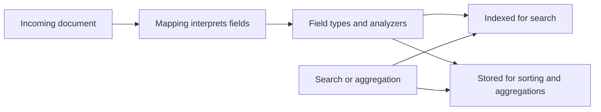
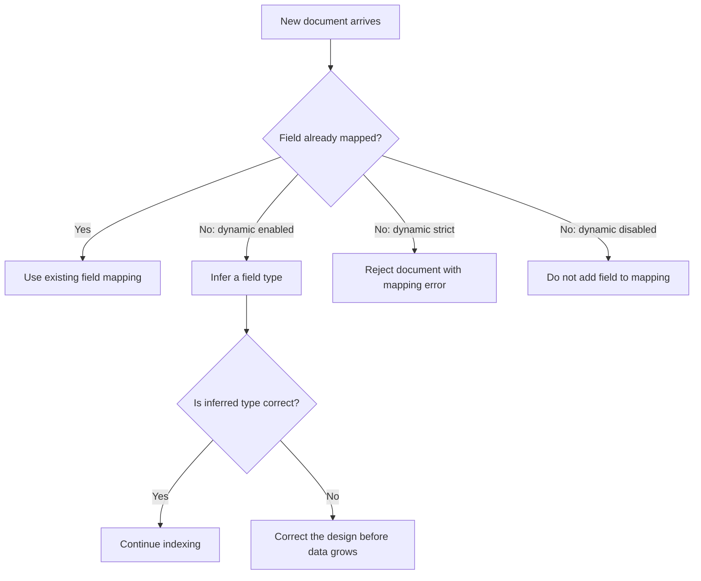
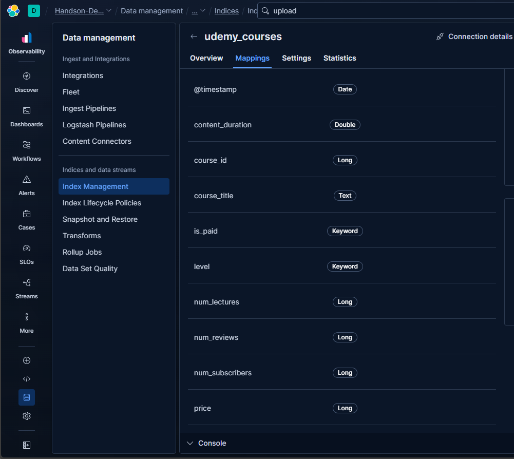

# Elasticsearch Mappings: Define How Data Is Indexed

> A mapping is the contract between your documents and your searches. Decide how fields should behave before production data makes those choices difficult to change.

## Table of contents

- [What is a mapping?](#what-is-a-mapping)
- [Why mapping design matters](#why-mapping-design-matters)
- [Dynamic and explicit mappings](#dynamic-and-explicit-mappings)
- [Text and keyword](#text-and-keyword)
- [Common field data types](#common-field-data-types)
- [Choosing numeric types](#choosing-numeric-types)
- [Inspect the Udemy courses mapping](#inspect-the-udemy-courses-mapping)
- [Create and update mappings](#create-and-update-mappings)
- [Mapping design checklist](#mapping-design-checklist)

## What is a mapping?

A mapping defines how Elasticsearch stores and indexes the fields in documents. It specifies field names, data types, and—where relevant—how values are analyzed for full-text search.

For example, the same string `"Business Finance"` could be mapped as:

- `text`, so it is analyzed and searchable by words.
- `keyword`, so it is treated as one exact value and can be filtered, sorted, or aggregated.

Elasticsearch uses the mapping to interpret incoming documents and to determine which searches and aggregations are supported. Mapping decisions affect query behavior, storage, and indexing cost.



## Why mapping design matters

Mapping design is important because it:

- Determines whether a field supports full-text search, exact matching, sorting, ranges, or aggregations.
- Helps Elasticsearch interpret dates, numbers, booleans, and structured objects correctly.
- Controls what is indexed and which data structures are maintained, affecting resource use and indexing behavior.
- Prevents ambiguous or inconsistent field interpretation as new documents arrive.

An incorrect field type can cause failed requests or silently unexpected results. For example, a price mapped as `keyword` cannot be used as a numeric range in the intended way. Many field types cannot be changed in place after data has been indexed. Correcting such a mistake usually means creating a new index with the desired mapping and reindexing the documents.

## Dynamic and explicit mappings

With **dynamic mapping**, Elasticsearch detects fields it has not seen before and attempts to infer their types from incoming values. This makes initial ingestion convenient, but inference may not match the application’s intended semantics. For example, a numeric-looking identifier may be inferred as a number even though it should only be treated as an exact identifier.

With an **explicit mapping**, you define important field types before indexing documents. This makes behavior intentional and consistent, especially for fields used in filtering, sorting, aggregations, or application contracts.

| Aspect | Dynamic mapping | Explicit mapping |
|---|---|---|
| How fields are defined | Elasticsearch infers types as new fields arrive. | The index creator specifies the types and options. |
| Best fit | Experiments, prototypes, or flexible data with controlled field growth. | Production data and fields whose query behavior matters. |
| Main risk | Inference may choose an unsuitable type; uncontrolled fields can cause mapping explosion. | Requires planning and coordination when the schema changes. |

Dynamic mapping can be constrained with settings such as `dynamic: strict` or controlled with dynamic templates. “Dynamic versus explicit” is not a permanent property of the whole index: an index can begin with explicitly defined fields and still dynamically map new fields unless configured otherwise.



Choose dynamic behavior deliberately. For example, `dynamic: strict` can prevent unexpected fields from being accepted, but it can also reject ingestion when producers add a legitimate new field before the mapping is updated.

## Text and keyword

`text` and `keyword` are both commonly used for strings, but they serve different search needs.

| Type | How the value is indexed | Typical use |
|---|---|---|
| `text` | Analyzed into terms, often with normalization such as lowercasing. | Descriptions, article bodies, and titles searched by words. |
| `keyword` | Indexed as a single exact value without full-text analysis. | Status, category, IDs, tags, sorting, and terms aggregations. |

For a field that needs both full-text search and exact operations, define a multi-field:

```json
{
  "course_title": {
    "type": "text",
    "fields": {
      "keyword": {
        "type": "keyword"
      }
    }
  }
}
```

Use `course_title` for full-text queries and `course_title.keyword` for exact-value operations when appropriate. Mapping a field as `keyword` does not mean it is encrypted or hidden; it describes indexing behavior.

## Common field data types

| Type | Examples and use |
|---|---|
| `text` | Analyzed full-text fields such as descriptions and titles. |
| `keyword` | Exact strings such as categories, status values, IDs, and URLs. |
| `boolean` | `true`/`false` values. |
| `byte`, `short`, `integer`, `long` | Signed integral values with progressively larger supported ranges. |
| `half_float`, `float`, `double` | Floating-point values; choose precision and range appropriate to the data. |
| `scaled_float` | Decimal-like values represented using a scaling factor, useful for some measurements and prices. |
| `date` | Timestamps and calendar dates, with supported formats. |
| `object` | A JSON object whose fields are mapped as properties. |
| `nested` | Arrays of objects that must retain per-object query relationships. |
| `ip` | IPv4 or IPv6 addresses. |
| `geo_point` | A geographic point, such as latitude and longitude. |

Do not choose a type only because the current sample values happen to fit. Consider the complete valid domain, future values, required query operations, precision, and producer formats.

## Choosing numeric types

Use the smallest numeric type that safely supports the documented value range and required precision. For example, `short` has a narrower signed integer range than `long`, so a field that can never exceed the `short` range might not need to be `long`.

However, choosing `short` does **not** guarantee that every document will consume exactly half the storage of a `long`. Elasticsearch/Lucene storage includes indexing structures, doc values, compression, cardinality, and segment-level overhead. Numeric type selection can help avoid unnecessarily wide ranges and makes the schema reflect the domain, but benchmark realistic data before making memory or disk capacity claims.

Avoid numeric types for identifiers that are never used in arithmetic. IDs with leading zeroes, alphanumeric characters, or exact-match semantics are usually better represented as `keyword`.

For prices, use an appropriate decimal strategy. If prices can contain fractional units, do not map them as `long` unless values are intentionally stored as whole units or scaled integers. A `scaled_float` with a suitable `scaling_factor` or a floating-point type may be appropriate depending on precision requirements and calculations.

## Inspect the Udemy courses mapping

Use the Get Mapping API to inspect how an existing index is currently mapped:

```http
GET /udemy_courses/_mapping
```

The Kibana **Mappings** tab presents the field names and their mapped types in a quick, visual overview:



*Kibana's Mappings tab showing fields and their types for `udemy_courses`.*

The notes contain this response excerpt:

```json
{
  "mappings": {
    "_meta": {
      "created_by": "file-data-visualizer"
    },
    "properties": {
      "@timestamp": {
        "type": "date"
      },
      "content_duration": {
        "type": "double"
      },
      "course_id": {
        "type": "long"
      },
      "course_title": {
        "type": "text"
      },
      "is_paid": {
        "type": "keyword"
      },
      "level": {
        "type": "keyword"
      },
      "num_lectures": {
        "type": "long"
      },
      "num_reviews": {
        "type": "long"
      },
      "num_subscribers": {
        "type": "long"
      },
      "price": {
        "type": "long"
      },
      "published_timestamp": {
        "type": "date",
        "format": "iso8601"
      },
      "subject": {
        "type": "keyword"
      },
      "url": {
        "type": "keyword"
      }
    }
  }
}
```

This is the mapping returned by an inspection request; it does not, by itself, prove that all these fields were created dynamically. The `_meta.created_by` value is metadata indicating the creator recorded for the mapping.

Review these fields against the data and searches:

- `course_title` is `text`, suitable for analyzed full-text search. If exact title filters, sorting, or terms aggregations are needed, add a keyword multi-field in a future index design.
- `is_paid` is `keyword`. If the source values are strictly true/false and boolean logic is intended, a `boolean` mapping is often clearer. Existing values and query usage must be checked before changing the design.
- `price` is `long`, so it represents whole-number values. If the dataset contains fractional prices, use a decimal-capable type and reindex into an appropriately mapped index.
- `course_id` and the count fields are `long`. If their valid ranges are known to be much smaller, a narrower integer type may be considered for a new index, but validate actual ranges and workload rather than assuming a specific storage saving.
- `subject`, `level`, and `url` are `keyword`, which suits exact filters and many aggregations.
- `content_duration` is `double`; confirm its unit and required precision so consumers interpret values consistently.

The mapping shows the current schema, not the distribution or actual values of indexed documents. Inspect representative source documents and validate query behavior as well.

## Create and update mappings

Define mappings when creating a new index:

```http
PUT /udemy_courses_v2
{
  "mappings": {
    "dynamic": "strict",
    "properties": {
      "course_id": {
        "type": "keyword"
      },
      "course_title": {
        "type": "text",
        "fields": {
          "keyword": {
            "type": "keyword"
          }
        }
      },
      "is_paid": {
        "type": "boolean"
      },
      "price": {
        "type": "scaled_float",
        "scaling_factor": 100
      },
      "subject": {
        "type": "keyword"
      },
      "published_timestamp": {
        "type": "date"
      }
    }
  }
}
```

This is an illustrative schema, not a drop-in replacement for the existing index. In particular, choose `course_id` as `keyword` only if it is an identifier rather than a value used in numeric operations, and choose a price scaling factor based on the source precision and application requirements. With `dynamic: strict`, documents containing unmapped fields are rejected, so all expected fields must be defined or added first.

Add a new field to an existing index with the Put Mapping API:

```http
PUT /udemy_courses_v2/_mapping
{
  "properties": {
    "instructor_name": {
      "type": "keyword"
    }
  }
}
```

This adds a field definition. It does not change an existing field from one type to another or retroactively populate an entirely new representation for old documents. To change an incompatible field type, create a destination index with the intended mapping, reindex the documents, validate the result, and then coordinate any application or alias switch. Treat reindexing and cutover as a planned migration.

## Mapping design checklist

- Decide which fields need full-text search and which need exact matching, sorting, or aggregations.
- Explicitly map critical fields and control dynamic field growth.
- Use numeric types only when numeric operations are meaningful; use `keyword` for identifiers that are not quantities.
- Check number ranges, units, decimal precision, and date formats against producer data.
- Use multi-fields when one string needs both full-text and exact-value behavior.
- Inspect mappings with `GET /<index>/_mapping` before debugging queries.
- Treat field-type changes as schema migrations that may require reindexing.
- Test query behavior and storage/indexing impact with representative data before production rollout.
