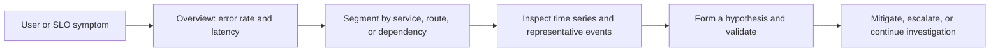
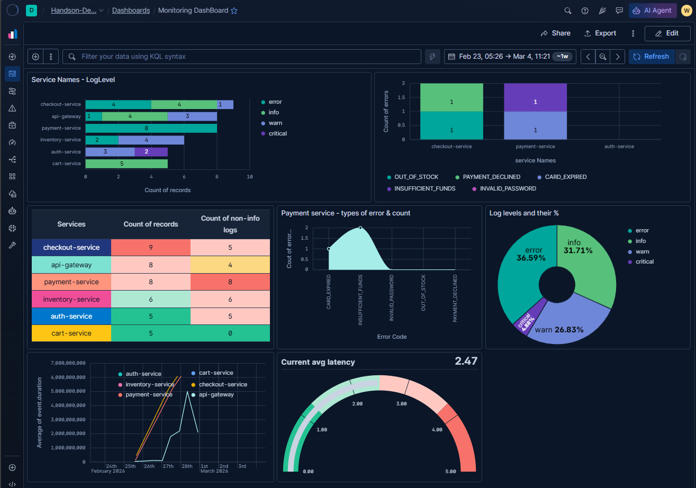

# Kibana Dashboards for Observability and SRE

> A monitoring dashboard should help an on-call engineer answer three questions quickly: Is a user-facing service unhealthy? What changed? Where should I investigate next?

## Table of contents

- [What a dashboard is for](#what-a-dashboard-is-for)
- [The observability workflow](#the-observability-workflow)
- [Reading the example dashboard](#reading-the-example-dashboard)
- [Common dashboard panel types](#common-dashboard-panel-types)
- [Designing for SREs](#designing-for-sres)
- [From dashboard to operational action](#from-dashboard-to-operational-action)

## What a dashboard is for

A Kibana dashboard brings together visualizations, tables, and other panels that use a common time range and filter context. It can provide a service overview, help an engineer investigate a symptom, or support a focused operational task.

A dashboard is not an alerting system or an SLO by itself. It helps people understand signals and investigate; alert rules and service objectives should define when action is needed and what level of reliability is expected.

## The observability workflow

An effective dashboard supports this progression from symptom to evidence. Keep high-level health signals visible and make it possible to narrow the view by service, environment, and time without losing context.

## Reading the example dashboard

The screenshot below is a Kibana **Monitoring Dashboard** with panels for service log levels, error categories, non-info log counts, payment errors, log-level proportions, event duration, and a current latency gauge.

*The panels below are discussed as an example of dashboard design, not as evidence of a production incident or SLO breach.*

### Service Names - LogLevel

The stacked horizontal bar chart compares log-record counts across services and log levels. It can help answer which services produce the most records and how their severity mix differs.

For SRE use, record volume is not the same as service health. A high-volume service may be operating normally, while one critical error from a low-volume service may be significant. Consider showing error counts and rates separately, and provide a way to inspect representative events.

### Count of errors by service and error code

The upper-right stacked chart breaks error counts down by service and error category. In the screenshot, checkout and payment services have visible error categories, while auth-service has no visible bar in this panel's selected time range.

That empty bar means no matching records were plotted for this query and time window; it does not by itself prove the service is healthy. Confirm telemetry coverage, filters, and ingestion before interpreting zero as zero failures. A useful follow-up is to click or filter a service/category and inspect the underlying events.

### Services table: count of records and non-info logs

The table gives service-level totals and counts of non-info logs. It is useful for ranking and exact comparison, especially when a chart makes nearby values hard to read.

The screenshot shows `payment-service` with 8 records and 8 non-info logs, while `cart-service` has 5 records and 0 non-info logs. These are counts in the displayed dashboard context, not rates. Add a time window and, where possible, a request or transaction denominator to distinguish increased traffic from increased failure likelihood.

### Payment service - types of error & count

This panel compares error categories for the payment service. Because the x-axis contains discrete error codes, a bar chart or table is usually easier to compare than an area chart: an area shape can imply continuity between categories that do not have a natural numeric order.

Use an ordered bar chart or table to make the count for each error type clear, and link each category to example logs or traces.

### Log levels and their %

The donut chart shows the relative share of log levels. In this screenshot, error is shown as 36.59%, info as 31.71%, and warn as 26.83%, with a smaller critical slice.

Percentages describe composition, not absolute impact. A change in the share can result from more errors, fewer info logs, or both. Pair percentages with total volume and an error count or rate; use a time series when the question is whether the signal is worsening.

### Average event duration over time

The lower-left time-series panel plots average `event.duration` by service. A time series is useful for spotting changes and comparing services, but an average can hide slow outliers. For user-facing latency, prefer percentiles such as p50, p95, and p99, and break them down by service or route when appropriate.

The chart's vertical scale reaches billions, but the screenshot does not establish the duration unit or whether the field is populated consistently. Confirm the instrumentation's unit and field mapping before translating these values into milliseconds or seconds. If the intended unit is nanoseconds, convert it for a human-readable display and label the axis explicitly.

### Current avg latency gauge

The gauge displays a current average latency value of `2.47` against a scale from 0 to 5, with colored bands. It provides a quick at-a-glance value, but the unit and the meaning of the thresholds are not visible in the screenshot.

Before using a gauge for on-call decisions, document the unit, time window, service scope, and threshold rationale. Average latency alone can look healthy while a small fraction of requests are very slow. Use percentile latency and an SLO-based threshold for operational alerting; keep a gauge as a compact summary if it adds value.

### Time picker and KQL bar

The header shows a selected time range and a KQL filter bar. This shared context is essential: every panel's result depends on its query, selected time range, and dashboard filters. During incident investigation, verify the time range and filters before comparing panels or sharing a screenshot.

## Common dashboard panel types

| Panel type | Good for | SRE considerations |
|---|---|---|
| Metric / single value | A current count, rate, or SLI summary. | Include units, time window, scope, and a meaningful comparison or threshold. |
| Line or area time series | Change and trends over time, including latency and error rate. | Use percentiles for latency; avoid smoothing that hides short incidents. |
| Bar chart | Comparing services, endpoints, or discrete error categories. | Sort deliberately and show values; use stacked bars only when composition is useful. |
| Data table | Exact values, ranking, and drill-down into entities. | Include the dimensions needed to identify an owner or next investigation step. |
| Pie or donut | A small number of categories as a proportion of a whole. | Pair with total volume; avoid many slices and do not use proportions as a substitute for rates. |
| Gauge | A compact reading against a defined range or threshold. | State units and threshold meaning; avoid using an average when tail behavior matters. |
| Heat map | Distribution or concentration across dimensions and time. | Define color semantics and ensure sparse data is not mistaken for healthy behavior. |
| Log/event table | Examining individual matching records. | Show useful fields, preserve timestamps, and provide links or filters for deeper investigation. |

Pick a visualization based on the question rather than variety. Several panel types that display the same count can make a dashboard look rich without making it more actionable.

## Designing for SREs

- **Start with user impact.** Put request success/error rate, latency percentiles, and traffic or throughput near the top when those signals exist.
- **Show a denominator.** Counts alone can mislead when traffic changes; use rates or normalize by requests where appropriate.
- **Make units explicit.** Label milliseconds, seconds, bytes, percentages, and time windows. Confirm source field units before changing display units.
- **Separate symptoms from causes.** Request-level SLIs show impact; infrastructure and dependency panels help investigate causes.
- **Support drill-down.** Allow filtering by service, environment, endpoint, region, or error category, and provide access to underlying logs/traces.
- **Design around SLOs.** Show the objective and current performance over a meaningful window. A dashboard color threshold is not automatically an SLO.
- **Handle missing data honestly.** Distinguish zero events from no telemetry, late ingestion, or a filter that excludes the data.
- **Reduce noise.** Keep panels focused, use consistent colors and labels, and remove visualizations that do not support a decision.
- **Keep access and data scope in mind.** Dashboards can expose sensitive log fields. Apply appropriate access controls and avoid sharing screenshots containing confidential data.

## From dashboard to operational action

Use the dashboard to establish whether impact is present, then investigate with the right level of detail:

1. Confirm the selected time range, environment, and dashboard filters.
2. Check user-facing error and latency signals against the relevant SLO.
3. Identify the affected service or error category, then compare with traffic and the previous baseline.
4. Drill into representative logs or traces; verify timestamps, units, and correlated fields.
5. Record the hypothesis and evidence before changing production systems.
6. After mitigation, confirm that user-facing signals recover and continue monitoring for recurrence.

The example dashboard is a useful starting point for exploring visualizations. To become an SRE-ready operational view, clarify units and thresholds, add rate and percentile-based service indicators, and connect summary panels to actionable drill-downs.
