# Beats and Fleet: Collecting Logs and Metrics

> Observability starts at the source. Filebeat and Metricbeat collect different signals; Fleet helps manage Elastic Agents and their integrations centrally.

## Table of contents

- [Beats in the observability pipeline](#beats-in-the-observability-pipeline)
- [Filebeat: collect and enrich logs](#filebeat-collect-and-enrich-logs)
- [Filebeat modules and dashboards](#filebeat-modules-and-dashboards)
- [Monitor logs in near real time](#monitor-logs-in-near-real-time)
- [Metricbeat: collect host metrics](#metricbeat-collect-host-metrics)
- [Data streams and indices](#data-streams-and-indices)
- [Fleet and Elastic Agent](#fleet-and-elastic-agent)
- [Standalone Beats or Fleet-managed Agent?](#standalone-beats-or-fleet-managed-agent)
- [Operational checklist](#operational-checklist)

## Beats in the observability pipeline

Beats are lightweight shippers that collect and send operational data to Elasticsearch or another supported output. For example:

- **Filebeat** tails log files or reads other configured inputs, then publishes log events.
- **Metricbeat** periodically collects system and service metrics such as CPU, memory, filesystem, network, and process data.

The shipper is one part of the pipeline. Collection configuration, connectivity, parsing, field conventions, retention, access control, and dashboards all affect whether the resulting data is useful.

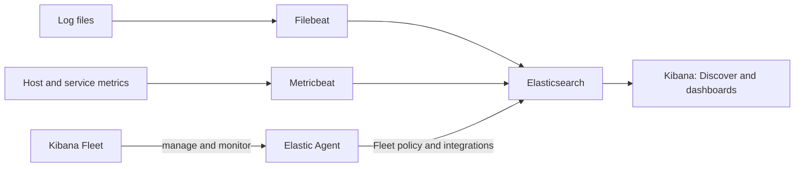

The diagram distinguishes the traditional standalone Beats workflow from the Fleet-managed Elastic Agent workflow. Fleet manages Elastic Agents; it does not turn an independently installed Filebeat or Metricbeat process into a Fleet-managed agent.

## Filebeat: collect and enrich logs

Filebeat can read log files as they are written and send events to Elasticsearch. A Filebeat event commonly includes the original message along with fields describing the host, input, file path, and—in module-based collection—the dataset and event category.

The screenshot below shows Filebeat output for SSH authentication activity. The event view includes messages about invalid usernames and authentication failures; its JSON view exposes fields such as the source file path, module/dataset, host metadata, and message. This is a useful example of why structured fields are more actionable than a line of raw text alone.

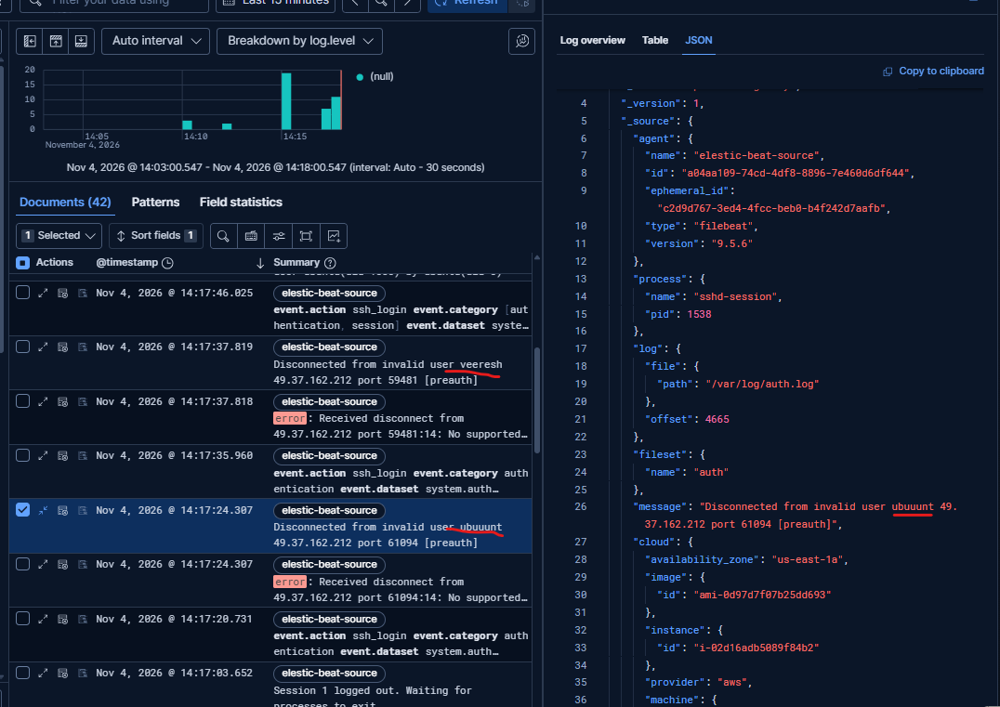

*Example log events collected from the authentication log. Treat usernames, IP addresses, and host details as potentially sensitive when publishing screenshots.*

### Configure and run Filebeat

The notes show Filebeat installed in a versioned directory on a Linux host. Before starting a Beat, review its configuration and ensure the output endpoint and credentials are configured securely.

Check the available commands:

```bash
./filebeat --help
```

The help output lists commands such as `modules`, `setup`, `test`, and `version`. The `-e` flag sends logs to standard error, which is convenient while validating a lab setup.

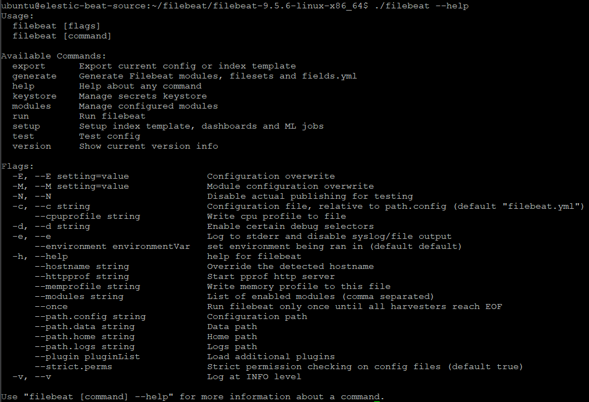

Validate the configuration and output connectivity before running the collector:

```bash
./filebeat test config -e
./filebeat test output -e
```

Load the assets required by the configured modules and dashboards:

```bash
./filebeat setup -e
```

The setup step is an administrative/bootstrap operation, not the long-running log collector. Run it when needed and confirm its output. It may require suitable Elasticsearch and Kibana access depending on the assets being installed and the configured outputs.

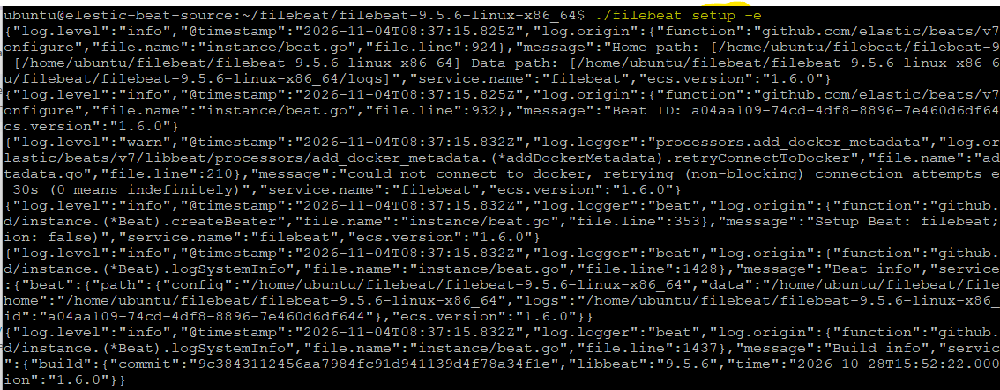

For a short lab, the notes demonstrate running Filebeat in the background:

```bash
nohup ./filebeat -e &
ps -aef | grep -i filebeat
```

`nohup` lets the process continue after a shell exits, but this is not a robust production service-management strategy: it does not provide the service lifecycle, restart policy, or operating-system integration expected for production. Use the supported service manager and deployment method for the host, and monitor the Beat's own health and logs.

The screenshot shows the process listing after Filebeat was started:

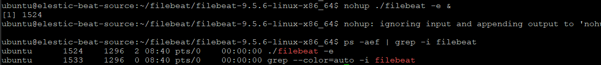

## Filebeat modules and dashboards

Filebeat modules provide prebuilt collection and parsing configuration for supported log sources. A module can define filesets and ingest pipelines that parse raw log lines into structured fields. Modules are convenient starting points, but verify paths, permissions, and source format for the actual host.

List the available and enabled modules:

```bash
./filebeat modules list
```

The screenshot shows the system module initially not enabled:

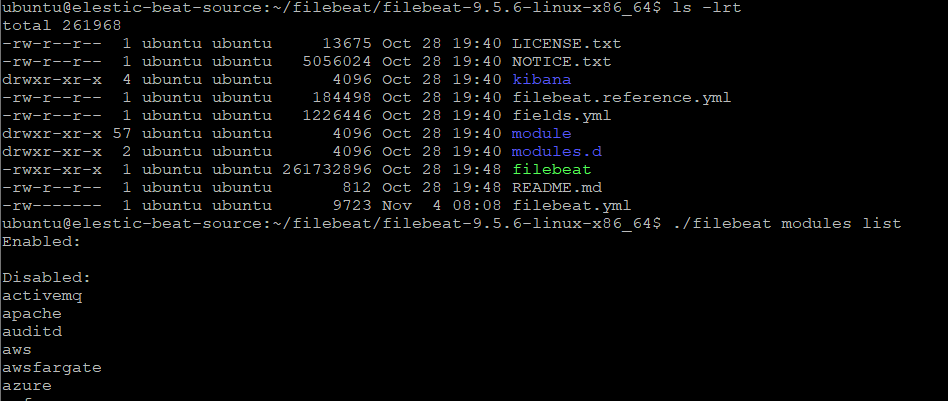

Enable the system module:

```bash
./filebeat modules enable system
./filebeat modules list
```

The enabled module appears in the list:

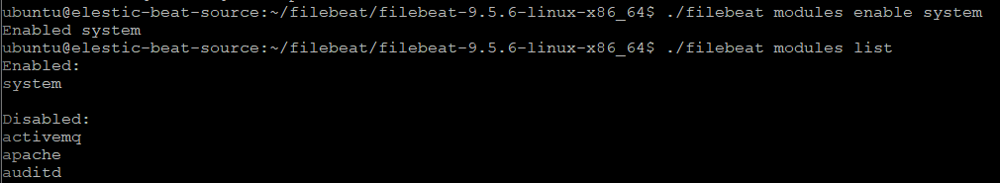

Module configuration is kept under `modules.d`. The system module example enables collection for syslog and authentication logs:

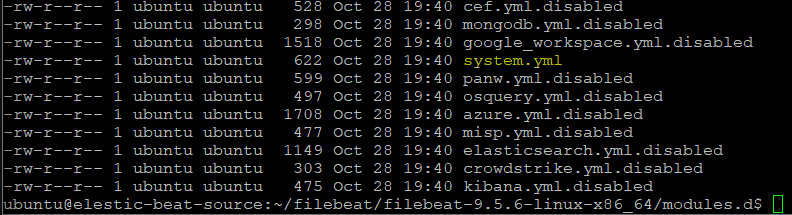

The relevant configuration is conceptually:

```yaml
- module: system
  syslog:
    enabled: true
  auth:
    enabled: true
```

The accompanying terminal screenshot shows `syslog.enabled` and `auth.enabled` set to `true` in the system module configuration:

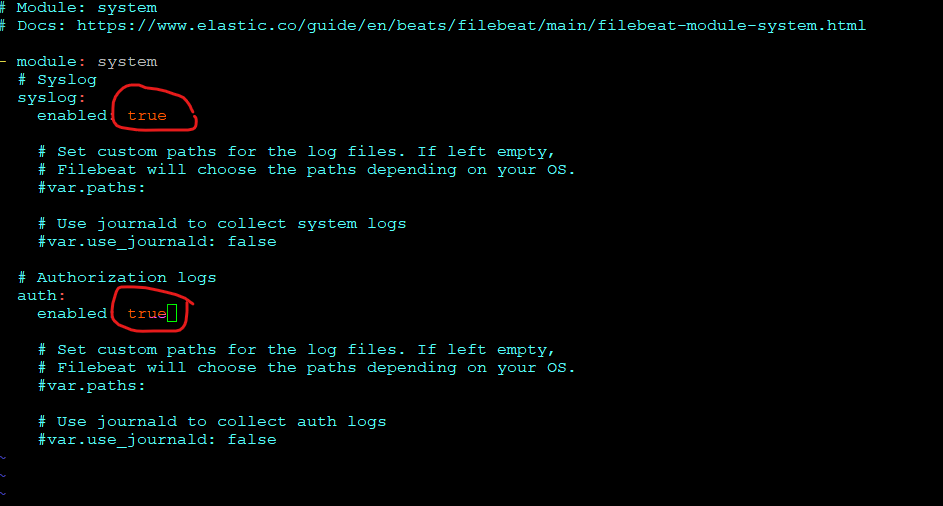

Default log paths vary by operating system and distribution. Inspect the module configuration and set paths if the defaults do not match the host. The Beat must also have permission to read the files; grant the minimum required access rather than running the collector with unnecessarily broad privileges.

After enabling or changing modules, validate the configuration and load the assets as appropriate:

```bash
./filebeat test config -e
./filebeat setup -e
```

Filebeat can install dashboards for supported modules. The Kibana screenshot shows dashboards available after searching for Filebeat-related dashboards:


Prebuilt dashboards accelerate exploration, but they are not automatically an operational service view. Check the dashboard's filters and time range, verify that the expected fields are populated, and adapt it to service ownership and incident response needs.

## Monitor logs in near real time

Filebeat monitors configured inputs and forwards newly observed events, making it possible to explore fresh log activity in Kibana. The screenshot demonstrates authentication events appearing over a selected time range. Actual end-to-end delay depends on file reading, publishing, network, ingest processing, indexing, and refresh behavior.

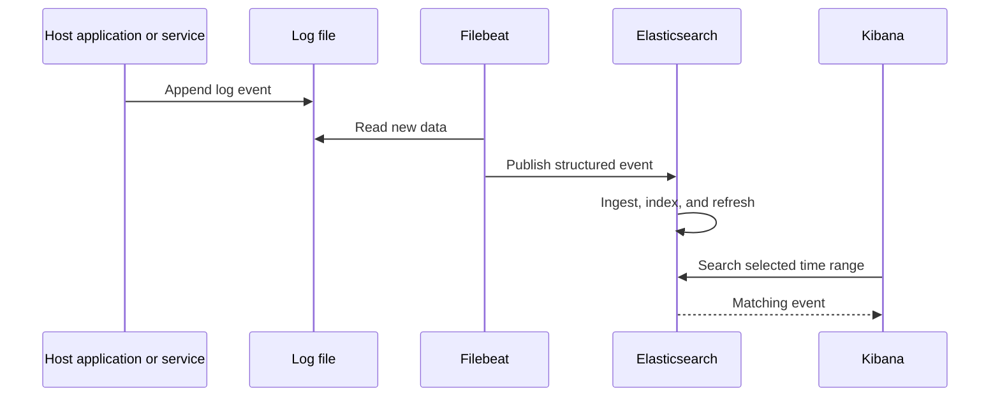

Use the event timestamp, ingestion time where available, and host identity to distinguish an application event's time from the time it became searchable. Avoid assuming that a missing event proves the application did not emit it: check the input path, permissions, Beat status, output errors, ingest pipeline, index/data-stream target, and Kibana filters.

## Metricbeat: collect host metrics

Metricbeat collects metrics at configured intervals. Its system module can gather CPU, load, memory, network, process, filesystem, and uptime metrics. The screenshot of `system.yml` shows examples with different collection periods: short intervals for CPU/load/memory/network/process, a longer interval for filesystem metrics, and a separate interval for uptime.

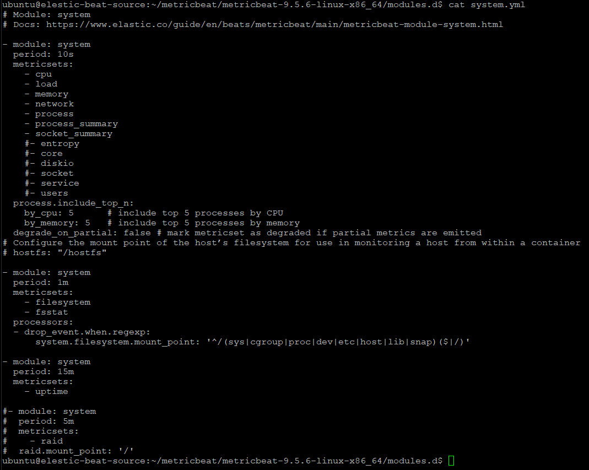

Collection cadence is a trade-off. Shorter periods provide more detail and quicker visibility but create more events and ingest/storage work. Select intervals based on the monitoring need, retention, and acceptable telemetry cost.

The notes show this lab workflow:

```bash
./metricbeat setup -e
nohup ./metricbeat -e &
ps -aef | grep -i metricbeat
```

As with Filebeat, validate configuration and output before starting, use setup for required assets, and use an operating-system service manager rather than `nohup` for a durable production installation.

### Explore Metricbeat data

The following Kibana screenshots show Metricbeat system dashboards filtered to the host `elastic-beat-source`. The first view includes CPU, memory, load, disk, network, and process summary panels. The second view shows network traffic over time and top processes by CPU or memory.

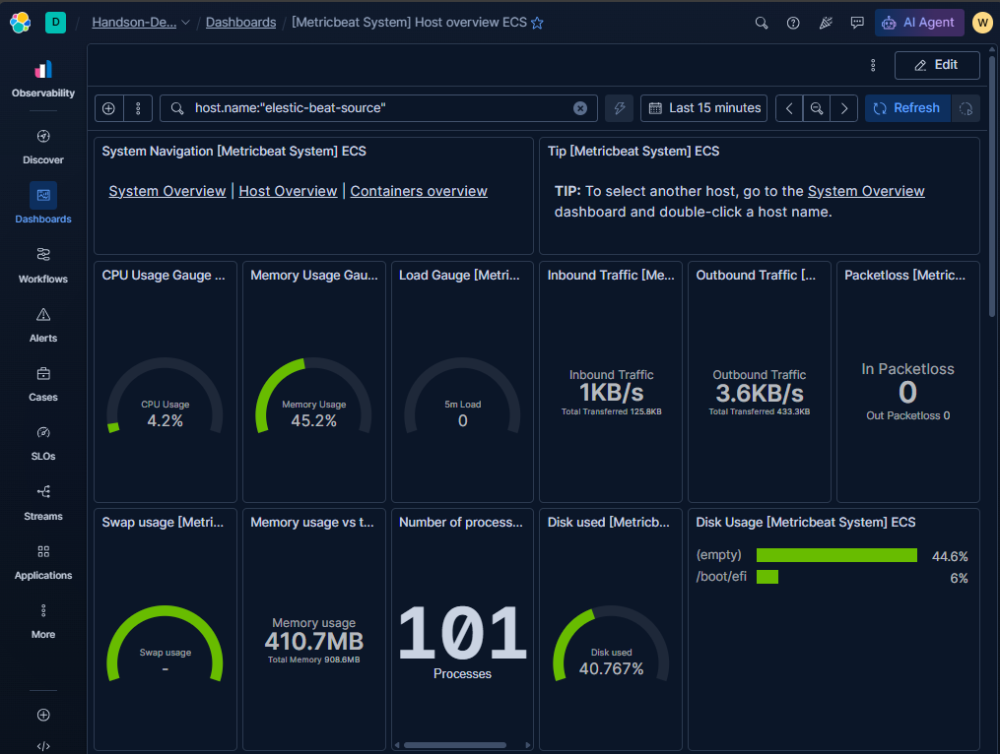

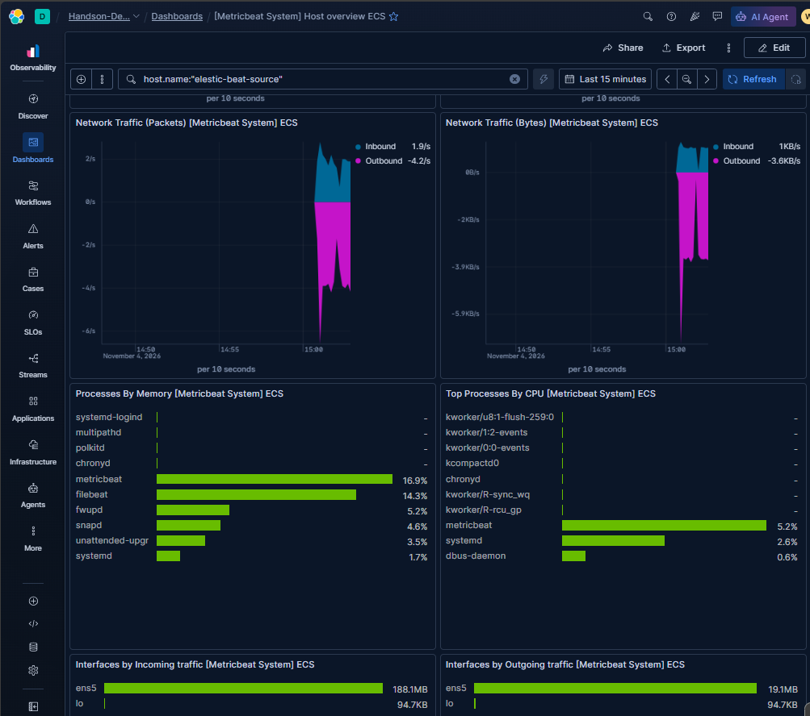

Use these panels to understand the host's observed resource signals, not as proof that an application is healthy. For example, CPU utilization alone does not establish user-facing latency; correlate infrastructure metrics with application errors, request rates, and traces. Also confirm host identity and dashboard time range before comparing machines.

## Data streams and indices

The screenshot shows a `filebeat-9.5.6` data stream in Kibana Index Management, including its health and backing-index count. A data stream is a logical write/read target designed for append-oriented time-series data such as logs and metrics. Writes go through the stream name while Elasticsearch manages its backing indices according to its template and lifecycle configuration.

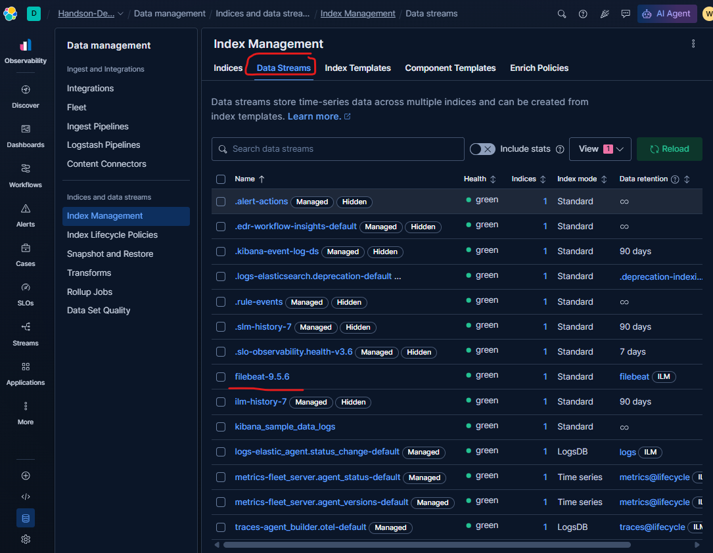

| Aspect | Data stream | Regular index |
|---|---|---|
| Typical workload | Append-oriented time-series events such as logs and metrics. | General-purpose documents, including mutable entity records and application data. |
| Write target | Write to the data stream name; Elasticsearch routes writes to its current write backing index. | Write directly to the index name. |
| Physical storage | A logical name backed by one or more managed indices. | A concrete index containing its own shards. |
| Lifecycle | Commonly paired with index templates and lifecycle/retention policies. | Lifecycle can be configured, but rollover behavior is not inherent in a regular index name. |
| Updates and deletes | Event-oriented workflows are the usual fit; update/delete operations have data-stream-specific constraints and may require targeting a backing index or using supported APIs. | Direct document updates and deletes by ID are conventional operations. |

Use a data stream when documents are time-stamped events that are primarily added and searched over time. Use a regular index for workloads that require direct mutable-record semantics or do not fit the data-stream model. A data stream still uses indices and shards underneath; it does not remove the need to plan mappings, shard sizing, retention, and access controls.

Before relying on a stream, inspect its template and lifecycle policy. Retention and rollover should be explicit operational decisions, not assumptions based only on the stream name or the presence of a data stream in the UI.

## Fleet and Elastic Agent

**Fleet** is Kibana's centralized management interface for **Elastic Agent**. Fleet lets an administrator define agent policies, attach integrations, enroll agents, and observe their status from a central place. An Elastic Agent receives its configuration from its assigned policy and can collect logs, metrics, and other supported telemetry through integrations.

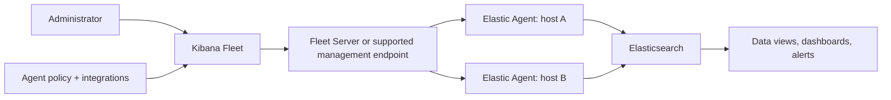

In deployments using Fleet Server, it provides the control-plane communication path between Fleet and enrolled agents. The exact management architecture depends on the deployment type and current Elastic version. Agent policies define what integrations and settings agents receive; agents send collected data to their configured output.

Fleet is useful when there are multiple hosts or centrally managed integrations because it can reduce per-host configuration drift and make agent status easier to observe. It also introduces operational responsibilities: enrollment tokens and policy changes must be protected, agent connectivity must be monitored, and upgrades should be staged and validated.

### Fleet and standalone Beats are related but distinct

- The Filebeat and Metricbeat commands shown above operate standalone Beat binaries using local configuration files.
- Fleet enrolls and manages Elastic Agent, which can collect logs and metrics through integrations.
- A standalone Filebeat process is not automatically enrolled in Fleet just because it publishes to the same Elasticsearch deployment.
- Choose a management approach intentionally. Avoid collecting the same source with both a standalone Beat and an Elastic Agent integration unless duplication is intended and controlled.

For a small lab, standalone Beats are useful for learning modules, YAML configuration, and shipper behavior. For centrally managed hosts, Elastic Agent with Fleet is often the more consistent operational model. Compare integration support, deployment constraints, data ownership, and upgrade requirements before selecting an approach.

## Operational checklist

- Confirm the host, input paths, permissions, and log format before enabling collection.
- Validate the Beat configuration and output connectivity before starting the process.
- Use modules/integrations to parse data where suitable, and verify parsed fields in Discover.
- Track the Beat or Agent's health, publish failures, dropped events, and configuration status.
- Set collection intervals, data-stream lifecycle, and retention to match operational needs.
- Protect credentials and enrollment tokens; do not commit them in configuration files or screenshots.
- Avoid duplicate collection from overlapping Beats and Elastic Agent integrations.
- Use dashboards as investigation aids and correlate logs/metrics with user-facing service indicators.
