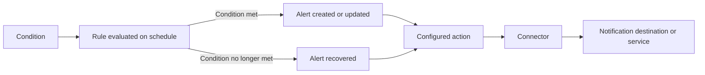
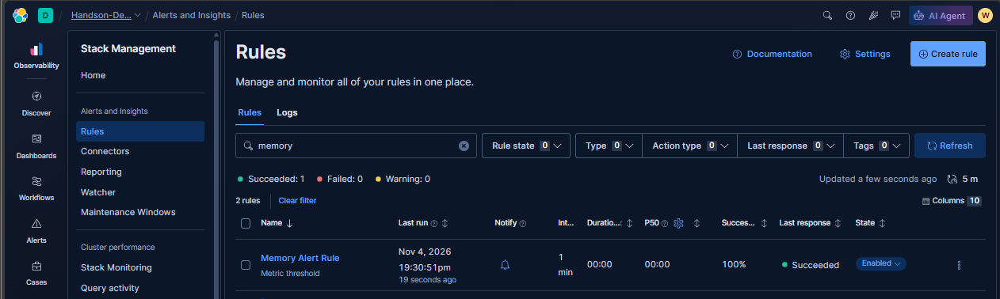
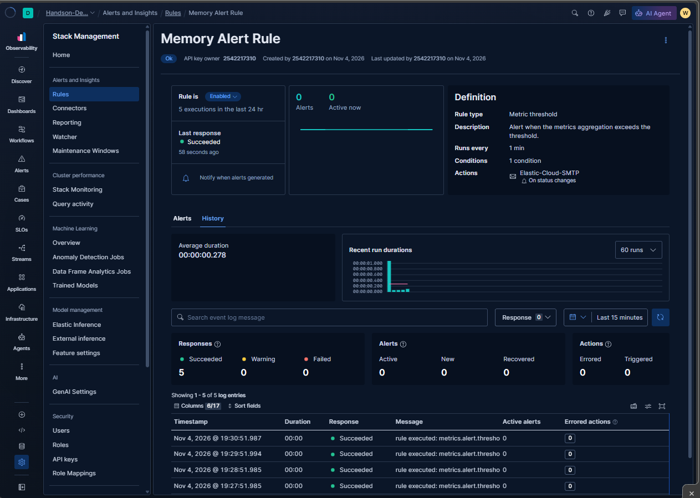

# Alerting in Kibana: Rules, Alerts, Actions, and Connectors

> Useful alerting turns a measurable condition into a timely, actionable notification—and makes it possible to verify whether the rule and its actions actually worked.

## Table of contents

- [Alerting concepts](#alerting-concepts)
- [How an alert is evaluated](#how-an-alert-is-evaluated)
- [Centralized rule management](#centralized-rule-management)
- [Example: Memory Alert Rule](#example-memory-alert-rule)
- [Connectors and actions](#connectors-and-actions)
- [SRE alert design](#sre-alert-design)
- [Testing and operations](#testing-and-operations)

## Alerting concepts

Kibana alerting is built around rules, generated alerts, actions, and connectors:

| Term | Meaning |
|---|---|
| **Rule** | A saved definition of what to evaluate, how often to evaluate it, and what to do when its state changes. |
| **Condition** | The logic that determines whether a rule should generate or recover an alert. The condition depends on the rule type. |
| **Alert** | A stateful result produced when a rule's condition is met. An alert can remain active, become new, or recover as the condition changes. |
| **Action** | A notification or other response configured on a rule, often run when an alert is generated, recovered, or otherwise changes state. |
| **Connector** | A reusable connection and authentication configuration that an action uses to reach a destination or service, such as email or another supported integration. |
| **Schedule** | How frequently the rule executes. A shorter interval can reduce detection delay but increases evaluation and notification activity. |

The rule is the logic and schedule; an alert is the state produced by evaluation; an action is the response; and a connector supplies the destination configuration. A rule can evaluate successfully even if a notification action fails, so monitor both rule executions and action outcomes.

## How an alert is evaluated

At each scheduled execution, a rule evaluates its condition against the relevant data or metrics. Depending on the rule type and the results:

1. The condition is met and an alert becomes active or is updated.
2. The condition is no longer met and an existing alert may recover.
3. The rule execution or an action can fail, producing an operational error that should be investigated separately from the monitored condition.

Actions may be configured for specific state changes, such as when an alert is generated or when it recovers. The exact available states and behavior depend on the rule type and configuration.

For threshold-style rules, schedules, lookback windows, aggregation choices, and threshold values affect detection. For example, an evaluation every minute is not the same as a one-minute averaging window; verify the rule type's condition and time-window behavior.

## Centralized rule management

The Rules page brings saved rules together so operators can inspect their status and manage them centrally. The screenshot shows a rule filtered by the word `memory`, a successful execution summary, its last run, interval, and enabled state.

From this view, an operator can review rules and their recent run/response status. A successful response indicates that the rule execution completed; it does not, by itself, prove that the underlying service is healthy or that a human received a notification.

Centralized visibility is valuable in an enterprise environment where many teams create rules. Keep ownership, purpose, severity, environment, and runbook information clear so that a large rule inventory remains maintainable.

## Example: Memory Alert Rule

The rule details screenshot shows a **Memory Alert Rule** with:

- The rule enabled and its most recent response marked successful.
- A **Metric threshold** rule type with one condition.
- A run interval of one minute.
- An action connector named `Elastic-Cloud-SMTP`, configured for status changes.
- A history view with execution durations, response counts, alert counts, and action counts.

The screenshot is an example of a configured lab rule, not a universal recommendation for memory thresholds or evaluation cadence. Its description says the rule alerts when a metrics aggregation exceeds a threshold, but the screenshot does not show the actual threshold, aggregation window, metric scope, or recipient configuration. Those details must be reviewed in the rule definition before relying on it.

The history is useful for distinguishing outcomes:

- **Response status** summarizes whether rule executions succeeded, warned, or failed.
- **Alerts** show alert-state activity, such as active, new, or recovered alerts.
- **Actions** show whether actions were triggered or errored.

Review these separately. A rule can execute successfully and generate no alerts; it can also generate an alert while its notification action errors.

## Connectors and actions

A **connector** stores the integration details used to reach a destination. An **action** is the rule's instruction to use that connector in response to an event or state change. For example, a rule may call an email connector when an alert is generated and send a separate message when it recovers.

Connector setup is separate from defining a rule's condition. Before relying on a connector:

- Verify that the destination is correct and monitored.
- Store credentials securely and grant the minimum permissions required.
- Test delivery using a non-critical rule or controlled test.
- Confirm notification templates include context such as rule name, affected entity, time, observed value, threshold, and a useful investigation link.
- Check action execution history, not just the rule's overall execution status.

Avoid sending the same high-volume signal to many destinations without a routing or ownership plan. Repeated notifications that contain no new information can obscure the alert that requires action.

## SRE alert design

- **Alert on impact or actionable risk.** Prefer user-visible symptoms and SLO signals over every internal metric fluctuation.
- **Define the condition precisely.** Document metric, aggregation, scope, threshold, evaluation cadence, and time window.
- **Set severity and ownership.** A notification should identify the responsible team and expected response.
- **Make alerts actionable.** Include what happened, where, when, the observed value, and the next diagnostic or runbook step.
- **Plan recovery behavior.** Decide whether recovery should notify, resolve a ticket, or update an incident channel.
- **Control noise.** Use sustained conditions, grouping, throttling, or appropriate action frequency where supported by the rule type.
- **Account for missing telemetry.** No data is not always zero; monitor collection and ingestion health if absence of data could hide an incident.
- **Consider maintenance windows.** Suppress or route expected notifications during planned work while preserving visibility into the change.
- **Review alert quality.** Track false positives, missed incidents, action failures, and alerts that repeatedly lack an owner or response.

The one-minute schedule shown in the example may be appropriate for a lab, but production cadence should reflect the signal, detection objective, data freshness, and cost of evaluation—not a default copied without analysis.

## Testing and operations

Before enabling an alert for an operational team:

1. Confirm the rule's data source, scope, and condition against real or representative telemetry.
2. Test both sides of the condition: a case that should trigger and a case that should recover or remain inactive.
3. Validate connector credentials and confirm delivery at the intended destination.
4. Inspect the rule history and action results after each test.
5. Confirm that notifications are understandable and include enough context to act.
6. Document ownership, severity, expected response, and the relevant runbook.
7. Revisit the rule after changes to metrics, index/data-stream mappings, service architecture, or SLOs.

Use the Rules list for fleet-wide inventory and the rule's history for execution-level troubleshooting. If an alert is missing, check the condition, time range/window, data availability, rule state, and execution response. If an alert exists but no one was notified, inspect the action configuration, connector, destination, and action errors.
