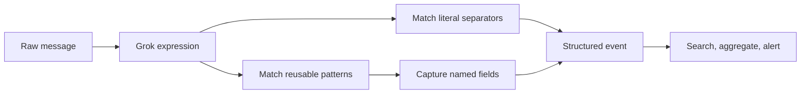
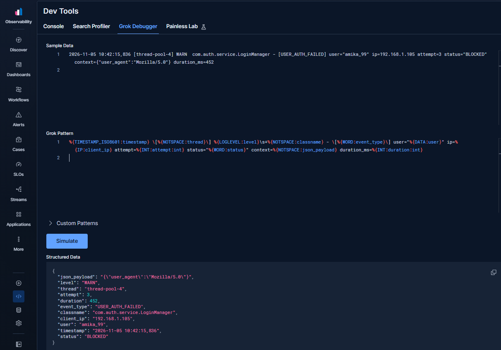
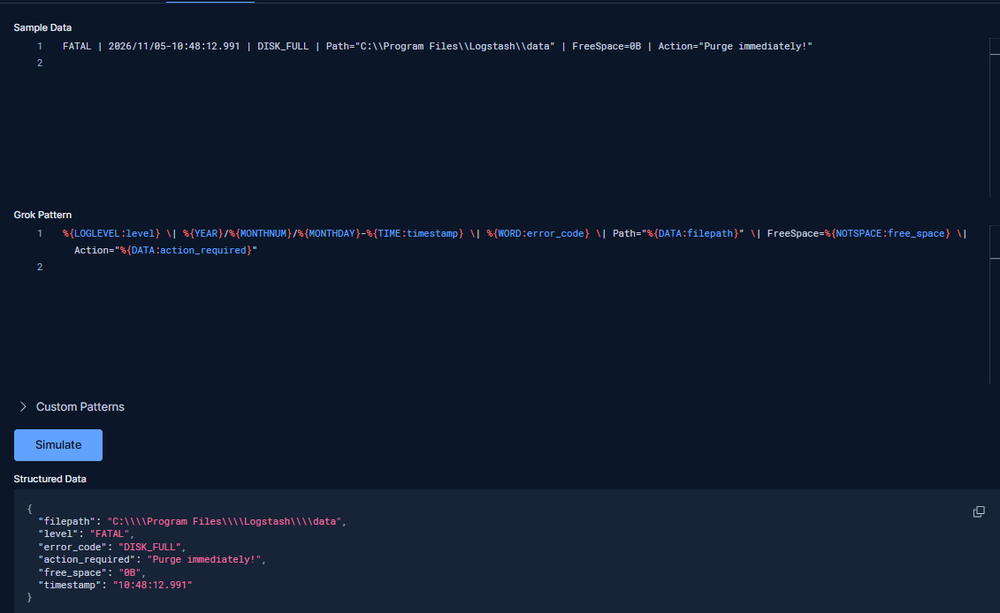
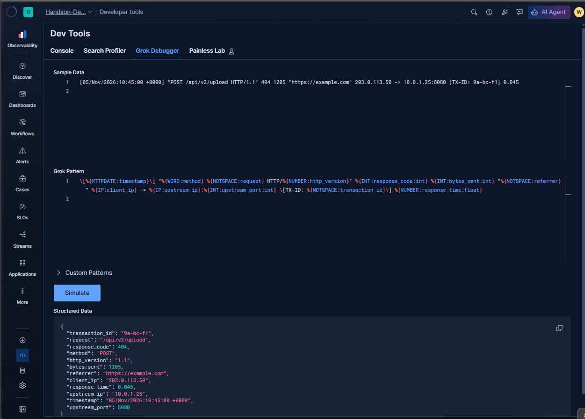

# Parsing Logs with the Logstash Grok Filter

> Grok turns unstructured text into named fields so logs can be searched, filtered, aggregated, and correlated.

## Table of contents

- [What is Grok?](#what-is-grok)
- [How Grok patterns work](#how-grok-patterns-work)
- [Why parse logs into fields?](#why-parse-logs-into-fields)
- [Try a pattern in Kibana Grok Debugger](#try-a-pattern-in-kibana-grok-debugger)
- [Parse a custom operational message](#parse-a-custom-operational-message)
- [Parse an Apache combined access log](#parse-an-apache-combined-access-log)
- [Handle parse failures](#handle-parse-failures)
- [Default patterns and custom patterns](#default-patterns-and-custom-patterns)
- [Run and validate a pipeline](#run-and-validate-a-pipeline)

## What is Grok?

Grok is a Logstash filter plugin for parsing semi-structured or unstructured text. It matches a message against a pattern and stores selected parts in fields on the Logstash event.

For example, a log line such as:

```text
FATAL | 2026/11/05-10:48:12.991 | DISK_FULL | Path="C:\Program Files\Logstash\data" | FreeSpace=0B | Action="Purge immediately!"
```

can be parsed into fields such as `level`, `error_code`, `filepath`, `free_space`, and `action_required`. Once structured, these values can be filtered, counted, visualized, and used in alerts without repeatedly searching the raw message.

## How Grok patterns work

A Grok expression combines literal text with named patterns. The general form is:

```text
%{PATTERN_NAME:field_name}
```

For example:

```text
%{IP:client_ip}
```

matches an IP address using the built-in `IP` pattern and stores it in `client_ip`.

Patterns can be composed to match an entire line. Literal punctuation and spacing must match the source format. Grok patterns are regular-expression based, so a pattern that is too broad or too complex can be difficult to maintain and may use more CPU than necessary.



## Why parse logs into fields?

- **Search precisely:** filter on `error_code: "DISK_FULL"` instead of matching a phrase in every raw message.
- **Aggregate and visualize:** count failures by level, service, path, or client IP.
- **Alert on meaningful conditions:** trigger when a structured error code or status exceeds an operational threshold.
- **Normalize different formats:** map source-specific names and values to consistent fields.
- **Preserve context:** keep the original message while also extracting fields for analysis.

Grok does not automatically make every captured field semantically correct. Decide whether values need further conversion, date parsing, normalization, or ECS-compatible field names before indexing.

## Try a pattern in Kibana Grok Debugger

Kibana's Grok Debugger lets you paste a sample message and a candidate pattern, then inspect the structured result before editing the production pipeline. The screenshot demonstrates a custom authentication message with fields for timestamp, thread, log level, class, event type, user, client IP, attempt number, status, context, and duration.



The debugger is useful for developing patterns, but successful parsing of one sample does not prove that the pattern handles all production variants. Test representative messages, optional fields, escaped characters, and malformed lines.

## Parse a custom operational message

The notes use this Logstash pipeline to parse the disk-space event:

```ruby
input {
  stdin {}
}

filter {
  if [message] and [message] != "" {
    grok {
      match => {
        "message" => '%{LOGLEVEL:level} \| (?<timestamp>%{YEAR}/%{MONTHNUM}/%{MONTHDAY}-%{TIME}) \| %{WORD:error_code} \| Path="%{DATA:filepath}" \| FreeSpace=%{NOTSPACE:free_space} \| Action="%{DATA:action_required}"'
      }
    }

    date {
      match => ["timestamp", "yyyy/MM/dd-HH:mm:ss.SSS"]
      target => "@timestamp"
    }
  }
}

output {
  stdout {
    codec => rubydebug
  }
}
```

The screenshot shows the input line, Grok pattern, and extracted fields:



The pattern matches the literal separators (`|`, labels, spaces, and quotes) and captures:

| Pattern | Captured field | Example |
|---|---|---|
| `%{LOGLEVEL:level}` | `level` | `FATAL` |
| `%{WORD:error_code}` | `error_code` | `DISK_FULL` |
| `%{DATA:filepath}` | `filepath` | `C:\Program Files\Logstash\data` |
| `%{NOTSPACE:free_space}` | `free_space` | `0B` |
| `%{DATA:action_required}` | `action_required` | `Purge immediately!` |

The custom named capture `timestamp` collects the full date and time; the `date` filter parses it using the corresponding pattern:

```ruby
date {
  match => ["timestamp", "yyyy/MM/dd-HH:mm:ss.SSS"]
  target => "@timestamp"
}
```

This sample has no timezone, so the date filter interprets it using the configured/default timezone behavior. Production log formats should include a timezone where possible; confirm timezone handling and fractional-second precision against real events. Logstash's default `@timestamp` is the event processing time, so parsing the source timestamp is important for accurate event-time analysis.

## Parse an Apache combined access log

For a supported common log format, use a built-in composite pattern such as `COMBINEDAPACHELOG` rather than maintaining a long custom expression:

```ruby
input {
  stdin {}
}

filter {
  if [message] and [message] != "" {
    grok {
      match => {
        "message" => "%{COMBINEDAPACHELOG}"
      }
    }

    date {
      match => ["timestamp", "dd/MMM/yyyy:HH:mm:ss Z"]
      target => "@timestamp"
    }
  }
}

output {
  stdout {
    codec => rubydebug
  }
}
```

The sample below is the kind of Apache access line used with the pattern:

```text
127.0.0.1 - frank [10/Oct/2000:13:55:36 -0700] "GET /apache_pb.gif HTTP/1.0" 200 2326 "http://example.com" "Mozilla/4.08 [en] (Win98; I)"
```

The debugger screenshot shows an Nginx-style access event parsed into fields such as request, response code, bytes sent, referrer, client IP, upstream endpoint, transaction ID, and response time:



The exact field names and format depend on the pattern used; Apache and Nginx formats are similar but not interchangeable in every deployment. Test the pattern against the actual access-log format, including optional fields and custom log formats.

## Handle parse failures

When Grok cannot match an event, Logstash normally adds the `_grokparsefailure` tag. The notes show this when an empty line is submitted. The conditional checks above skip empty messages; for production input, also decide how to handle non-empty malformed lines.

Common causes include:

- The source format changed or has optional fields.
- A literal separator, quote, escape, or whitespace differs from the pattern.
- The wrong built-in pattern was selected for the log format.
- A line is truncated or malformed.
- The pattern assumes a field is always present when it is optional.

Do not silently discard parse failures. Preserve the original message, count failures, and route them to a quarantine or review destination when appropriate. This makes format drift visible and avoids losing evidence needed to update the parser.

## Default patterns and custom patterns

Logstash includes many reusable patterns for common values and formats. Examples include:

| Pattern | Typical match |
|---|---|
| `WORD` | A word-like token. |
| `INT` | An integer value. |
| `NUMBER` | A numeric value, including decimal forms. |
| `IP` | An IPv4 or IPv6 address. |
| `LOGLEVEL` | A common log severity such as `INFO`, `WARN`, or `FATAL`. |
| `DATA` | A non-greedy match for text, often used between known delimiters. |
| `GREEDYDATA` | A greedy match for the remaining text; use carefully. |
| `COMBINEDAPACHELOG` | A composite pattern for Apache combined access logs. |

The authoritative pattern definitions are maintained in the [Logstash Patterns Core GitHub repository](https://github.com/logstash-plugins/logstash-patterns-core/tree/main/patterns), including the [ECS-compatible patterns](https://github.com/logstash-plugins/logstash-patterns-core/tree/main/patterns/ecs-v1) and [legacy patterns](https://github.com/logstash-plugins/logstash-patterns-core/tree/main/patterns/legacy).

Define custom patterns when the source format has domain-specific tokens or when a named pattern improves readability and reuse. Keep custom definitions version-controlled and test them alongside representative log samples.

## Run and validate a pipeline

1. Save the pipeline in a configuration file such as `grok.conf`.
2. Start Logstash with the configuration:

   ```bash
   ./bin/logstash -f grok.conf
   ```

3. Paste or pipe representative log lines into the configured input.
4. Inspect the structured event using `stdout { codec => rubydebug }`.
5. Confirm expected fields, field values, timestamp behavior, and parse-failure handling.
6. Test valid, optional, and malformed variants before connecting the pipeline to a production output.

Use Kibana Grok Debugger for quick pattern iteration and a repeatable Logstash test pipeline for end-to-end validation. A debugger match is a useful development signal, not a substitute for testing the full input, filter, and output configuration.
