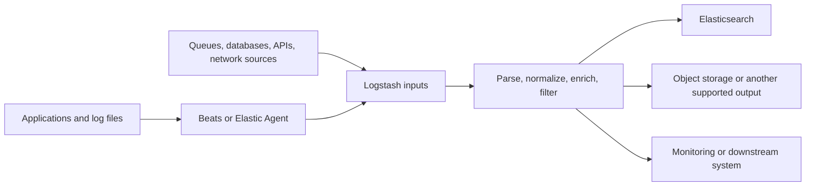
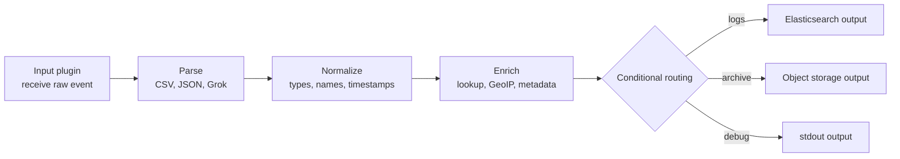

# Logstash: Transform, Enrich, and Route Data

> Logstash is a pipeline engine for receiving events, transforming them, and sending them to one or more destinations. It is most valuable when collection needs become integration and data-processing requirements.

## Table of contents

- [Where Logstash fits](#where-logstash-fits)
- [Logstash, Beats, and Elastic Agent](#logstash-beats-and-elastic-agent)
- [The pipeline: input, filter, output](#the-pipeline-input-filter-output)
- [CSV pipeline: stdin to stdout](#csv-pipeline-stdin-to-stdout)
- [A routing and enrichment example](#a-routing-and-enrichment-example)
- [Logstash configuration files](#logstash-configuration-files)
- [Buffering, backpressure, and spikes](#buffering-backpressure-and-spikes)
- [Troubleshooting memory pressure](#troubleshooting-memory-pressure)
- [Use cases beyond Elasticsearch](#use-cases-beyond-elasticsearch)
- [Operational checklist](#operational-checklist)

## Where Logstash fits

Logstash is an event-processing service in a data pipeline. It can receive events from files, queues, network protocols, databases, and other supported inputs; apply parsing, transformation, enrichment, and routing; then publish to Elasticsearch or other supported outputs.



Logstash can sit between shippers and destinations, or collect directly from supported sources. Whether it belongs in a particular pipeline depends on the transformations, routing, throughput, and operational complexity required.

## Logstash, Beats, and Elastic Agent

These products overlap in some capabilities but serve different roles. Beats and Elastic Agent can perform useful processing, and Elasticsearch ingest pipelines can also transform documents. It is therefore inaccurate to say that all transformations are impossible without Logstash.

| Capability | Beats / Elastic Agent | Logstash |
|---|---|---|
| Collection | Lightweight collection close to the source; Elastic Agent also supports centrally managed integrations through Fleet. | Has input plugins for a broad range of source and transport types; can also receive data from shippers. |
| Processing | Supports processors and integrations for common filtering, enrichment, and normalization needs. | Provides a dedicated pipeline with a broad plugin ecosystem for parsing, transformation, enrichment, and event routing. |
| Complex transformations | Suitable for common source-side processing; complex or shared processing can become harder to maintain across many hosts. | Often a better fit for multi-step processing, conditional logic, plugin-based parsing, and centralized transformation. |
| Multiple outputs | Depends on the shipper, integration, and configuration. | A pipeline can publish to multiple outputs and route events conditionally. |
| Buffering | Collection agents have their own publishing and buffering behavior. | Persistent queues and pipeline flow control can absorb some downstream interruptions or bursts, within configured disk and capacity limits. |
| Operational footprint | Usually lightweight and distributed across hosts. | A separate JVM service with its own capacity, availability, configuration, and upgrade requirements. |

Logstash is not automatically better or more reliable. It adds a processing hop and becomes another service to operate. Use it when its centralized processing, integration, or routing capabilities solve a concrete requirement; otherwise, a direct shipper-to-Elasticsearch path or an Elasticsearch ingest pipeline may be simpler.

### What Logstash can add

- **Complex transformation:** combine filters such as `grok`, `csv`, `date`, `mutate`, `aggregate`, and conditionals to normalize heterogeneous records.
- **Data enrichment:** add fields from lookup data or enrichment plugins, such as translating codes into labels or enriching IPs with location data when an appropriate plugin/database and data-governance approval are in place.
- **Multiple outputs:** send the same or conditionally selected events to Elasticsearch and another supported system.
- **Centralized routing:** send different event types to different indices, clusters, queues, or external systems based on fields or tags.
- **Buffering and backpressure:** use a persistent queue to absorb bounded interruptions or spikes and prevent a slow output from immediately requiring every input to stop.

These capabilities are not unlimited. Buffering does not create infinite capacity, and it does not replace a durable message broker for every architecture. If input outpaces processing for long enough, queues fill and backpressure must eventually reach producers or events may be rejected, delayed, or otherwise affected according to the pipeline and plugin behavior.

## The pipeline: input, filter, output

A Logstash pipeline has three stages:

| Stage | Responsibility | Example plugins |
|---|---|---|
| **Input** | Receive events and create Logstash events. | `stdin`, `file`, `beats`, `tcp`, `http`, `kafka`, `jdbc` |
| **Filter** | Parse, transform, enrich, drop, or annotate events. | `csv`, `grok`, `json`, `date`, `mutate`, `geoip`, `translate` |
| **Output** | Send events to one or more destinations. | `stdout`, `elasticsearch`, `kafka`, `s3`, `http`, `file` |

Each plugin is configured inside its stage. A pipeline can have multiple inputs, filters, and outputs. Filters run for events received by the pipeline, subject to conditionals; outputs can use conditionals to route different events to different destinations.



The order matters. Parse the source before referring to newly extracted fields, normalize types and timestamps before indexing, and use conditionals when destinations need different event sets.

## CSV pipeline: stdin to stdout

The first example parses the CSV records from the supplied `product.csv` file. The `stdin` input creates an event for each input line; the `csv` filter extracts columns from the event's `message`; the `stdout` output prints the resulting event for inspection.

Save this as `products.conf` in the Logstash working directory:

```ruby
input {
  stdin {}
}

filter {
  if [message] and [message] != "" {
    csv {
      source => "message"
      separator => ","
      columns => [
        "id",
        "timestamp",
        "paymentType",
        "name",
        "gender",
        "ip_address",
        "purpose",
        "country",
        "age"
      ]
      convert => {
        "id" => "integer"
        "age" => "integer"
      }
    }

    date {
      match => ["timestamp", "ISO8601"]
      target => "@timestamp"
    }
  }
}

output {
  stdout {
    codec => rubydebug
  }
}
```

Run it from the Logstash installation directory:

```bash
tail -n +2 product.csv | ./bin/logstash -f products.conf
```

`tail -n +2` skips the CSV header because this example defines the column names in the filter. If you send the header as data, it can be parsed as an ordinary record instead. The conditional skips empty input lines, which can otherwise produce CSV parsing warnings.

What the configuration does:

1. **`stdin` input** reads each incoming line into the event's `message` field.
2. **`csv` filter** splits `message` on commas and assigns the values to the named fields.
3. **`convert`** changes `id` and `age` from strings to integers. Other CSV values remain strings unless converted.
4. **`date` filter** parses the ISO-8601 `timestamp` field and sets the event's `@timestamp`.
5. **`stdout` output** prints a Ruby-debug representation for inspection. This is human-readable, but is not strict JSON.

If strict JSON Lines output is needed for another tool, use `codec => json_lines` on the `stdout` output. Ensure the CSV quoting and escaping rules match the source file; a simple comma-separated sample does not test edge cases such as commas inside quoted fields.

The source notes show a CSV filter warning involving an empty `message`. The conditional above guards against empty lines. If parsing still fails, inspect the raw input, header handling, delimiter, quote character, and the event's `message` value before changing the pipeline.

### Plugin examples used here

- **`csv` filter:** parses delimited text into named event fields; `source`, `separator`, and `columns` describe how to interpret the input.
- **`date` filter:** parses a timestamp field into Logstash's event timestamp so downstream systems can query events by event time rather than only ingestion time.
- **`stdout` output:** useful for local pipeline validation; it is generally a diagnostic output, not a production destination.

## A routing and enrichment example

The following illustrative pipeline parses JSON events, normalizes a field, adds a processing marker, and routes selected events to Elasticsearch while also writing all events to a local archive file.

```ruby
input {
  http {
    port => 8080
    codec => json
  }
}

filter {
  mutate {
    lowercase => ["service"]
    add_field => {
      "[@metadata][processed_by]" => "logstash"
    }
  }

  if [severity] == "critical" {
    mutate {
      add_tag => ["urgent"]
    }
  }
}

output {
  if "urgent" in [tags] {
    elasticsearch {
      hosts => ["https://elasticsearch.example:9200"]
      index => "critical-events"
      user => "${ES_USER}"
      password => "${ES_PASSWORD}"
    }
  }

  file {
    path => "/var/log/logstash/archive-%{+YYYY-MM-dd}.json"
    codec => json_lines
  }
}
```

This example demonstrates plugin roles and conditional output routing; it is not a complete production deployment. Configure TLS trust, authentication, destination index templates, file permissions, rotation, and secret management for the actual environment. A pipeline with multiple outputs can duplicate data by design, and a failure in one destination needs to be monitored independently from another destination's success.

## Logstash configuration files

| File or configuration | Purpose |
|---|---|
| `config/logstash.yml` | Node-level settings such as node identity, API endpoint, paths, logging, and pipeline monitoring configuration. |
| `config/pipelines.yml` | Defines one or more pipelines, their IDs, configuration paths, and selected pipeline-level settings. |
| Pipeline `.conf` files | Define each pipeline's `input`, `filter`, and `output` plugins. These are the files passed with `-f` for a simple lab. |
| `config/jvm.options` | JVM startup options, including heap settings such as `-Xms` and `-Xmx`. |
| `config/log4j2.properties` | Log4j2 logging configuration for Logstash's own application logs. |
| `config/startup.options` | Startup configuration used by supported package/service installations. It is not normally the first file to edit for a simple pipeline. |

For a lab, `./bin/logstash -f products.conf` loads one pipeline configuration directly. A managed installation can use `pipelines.yml` to run multiple named pipelines, each with its own settings and configuration paths. Keep secrets out of committed `.conf` files; use the supported secure settings or environment/secret-management mechanism for the deployment.

## Buffering, backpressure, and spikes

Logstash's **persistent queue (PQ)** stores in-flight events on disk so a pipeline can better tolerate a temporary output slowdown or restart. It is configured per pipeline and has a finite capacity. Without an appropriately configured PQ, in-flight buffering is more dependent on memory and plugin behavior.

| Situation | What can help | What it does not guarantee |
|---|---|---|
| Short output interruption | Persistent queue can retain events while the output is unavailable, up to its configured capacity. | It does not guarantee indefinite retention or protect against every disk, host, or corruption failure. |
| Brief traffic spike | Queueing and pipeline flow control can smooth a bounded burst. | It does not make sustained input rates above processing/output capacity stable. |
| Slow destination | Backpressure can slow upstream processing as queues fill. | It does not remove the need to monitor queue growth and output errors. |
| Durable event buffering across infrastructure failures | A suitably designed external broker may provide an additional decoupling layer. | A Logstash PQ is not a substitute for an independently operated, replicated message broker when the durability objective requires one. |

Plan queue disk capacity, filesystem space, throughput, and recovery time. Alert on queue utilization and growth, output failures, pipeline worker utilization, and event latency. A queue that repeatedly approaches capacity is evidence of a throughput or downstream problem—not simply a reason to increase the queue indefinitely.

## Troubleshooting memory pressure

The notes describe Logstash running on a small AWS `t3.micro` host and being terminated by the Linux out-of-memory killer. The kernel log excerpt identifies the killed process as Java, which is consistent with Logstash's JVM process being selected under host memory pressure.

Check kernel messages when a process appears to disappear unexpectedly:

```bash
sudo dmesg -T | grep -i -E 'kill|oom'
```

The lab was stabilized by reducing the configured JVM heap in `config/jvm.options`:

```text
-Xms512m
-Xmx512m
```

This is an observation from that lab instance, not a general production heap recommendation. A smaller heap can reduce Java's maximum heap reservation, but Logstash also needs memory outside the JVM heap, and the operating system and other processes need memory too. On a constrained host, a 512 MB heap may still be too large or may leave insufficient capacity for the workload.

When diagnosing:

1. Confirm the kernel OOM evidence and identify which process was killed.
2. Check host memory, swap, concurrent processes, pipeline workers, batch size, and plugin behavior.
3. Size the host and JVM heap together; do not set `-Xms`/`-Xmx` without leaving room for native memory and the operating system.
4. Reduce unnecessary pipeline work or concurrency and test again with representative data.
5. Monitor sustained memory pressure, pipeline backpressure, queue growth, and throughput after the change.

For production, address the capacity constraint rather than relying solely on a smaller heap to suppress OOM events. Avoid using a very small instance for sustained high-volume processing.

## Use cases beyond Elasticsearch

Logstash is not limited to Elasticsearch as an output. Depending on the required plugins and deployment, it can support pipelines such as:

- **Central log normalization:** parse logs from different applications and route normalized events to Kafka, object storage, or a search platform.
- **Security-event enrichment:** enrich authentication or network events with approved inventory or lookup data before sending them to a SIEM or archive.
- **Legacy system integration:** read from a database or file feed, transform the records, and publish to a queue or HTTP endpoint.
- **Data lake ingestion:** validate and reshape events before writing to object storage for later batch analysis.
- **Multi-destination delivery:** send a searchable copy to Elasticsearch while retaining an archive or forwarding selected events to another supported system.

Check plugin availability, licensing, data-protection requirements, delivery semantics, and operational ownership before selecting a non-Elastic destination. A pipeline's ability to connect to a destination does not by itself guarantee exactly-once delivery or end-to-end durability.

## Operational checklist

- Use Logstash when its transformation, enrichment, integration, or routing capabilities justify another service in the path.
- Validate the pipeline with representative input, including malformed, empty, and edge-case records.
- Convert string fields to numeric or date types deliberately before indexing or downstream calculations.
- Monitor pipeline throughput, output failures, event latency, JVM/host memory, persistent queue usage, and disk capacity.
- Treat PQ as bounded protection, not infinite buffering; understand where backpressure reaches producers.
- Configure and test every output independently, especially when one pipeline has multiple destinations.
- Keep credentials out of pipeline files and use secure secret handling.
- Size Logstash and its JVM based on measured workload, not only on a successful low-volume lab run.
