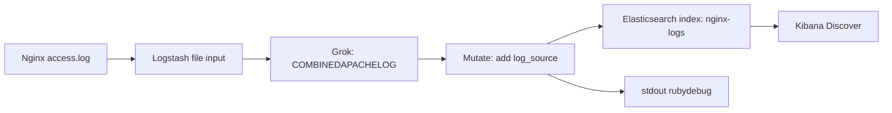
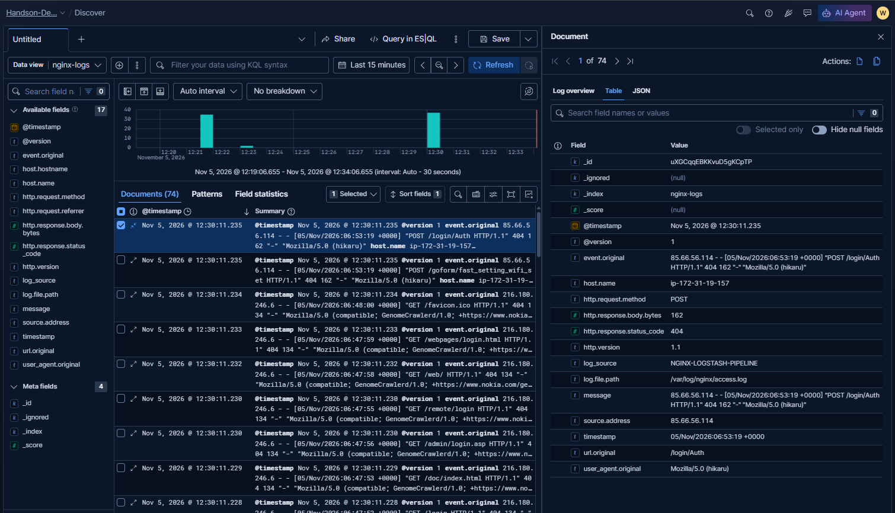
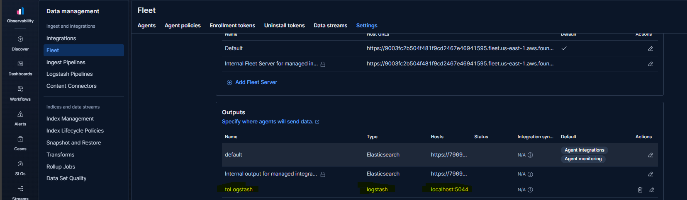

# Nginx Access Logs: Logstash Pipeline

> This lab follows Nginx access events from a local log file through Logstash parsing and enrichment into Elasticsearch, with stdout output for inspection.

## Table of contents

- [Pipeline overview](#pipeline-overview)
- [Stage 1: Read and forward raw logs](#stage-1-read-and-forward-raw-logs)
- [Stage 2: Parse and enrich with Grok](#stage-2-parse-and-enrich-with-grok)
- [What the parsed fields provide](#what-the-parsed-fields-provide)
- [Configure Elasticsearch output securely](#configure-elasticsearch-output-securely)
- [Fleet output to Logstash](#fleet-output-to-logstash)
- [Operational considerations](#operational-considerations)

## Pipeline overview

The lab reads Nginx access log lines from `/var/log/nginx/access.log`. The initial configuration forwards the raw event to Elasticsearch and prints it locally. A later version adds Grok parsing and a `log_source` field before sending it to the same output.



The screenshots show the indexed events in Discover and an Elastic Agent output configuration that points to Logstash. The latter is a separate ingestion path: an agent can send supported data to a Logstash listener when its output is configured for it.

## Stage 1: Read and forward raw logs

The first pipeline version reads the Nginx access log and writes each line to Elasticsearch and stdout:

```ruby
input {
  file {
    path => "/var/log/nginx/access.log"
    start_position => "beginning"
    sincedb_path => "/var/lib/logstash/sincedb/nginx-access"
  }
}

output {
  elasticsearch {
    cloud_id => "${ES_CLOUD_ID}"
    user => "${ES_USER}"
    password => "${ES_PASSWORD}"
    index => "nginx-logs"
  }

  stdout {
    codec => rubydebug
  }
}
```

The input and output stages work as follows:

- **`file` input:** tails the configured log file and creates an event for each new line.
- **`start_position => "beginning"`:** starts at the beginning when Logstash first encounters a file. It does not override the saved read position on every restart.
- **`sincedb_path`:** stores file offsets so Logstash can resume reading without unnecessarily replaying the entire file. Use a persistent, writable path appropriate to the installation.
- **`elasticsearch` output:** sends events to the configured Elasticsearch deployment and index.
- **`stdout` output:** prints events to Logstash's console/log output for lab inspection; it is usually removed or redirected appropriately in production.

In the original lab notes, `sincedb_path` was set to `/dev/null`. This disables persisted file-position tracking and can cause the file to be read again after restarts, creating duplicate events. That can be useful for a controlled replay exercise, but is generally not suitable for continuous ingestion.

Run the pipeline from the Logstash installation directory:

```bash
./bin/logstash -f nginx.conf
```

The raw-event output includes `message`, `event.original`, `host`, and `log.file.path`. It is enough to confirm collection, but fields such as HTTP status and request path are not yet available as typed fields for focused analysis.

## Stage 2: Parse and enrich with Grok

The second version adds the `grok` filter and a `mutate` filter:

```ruby
input {
  file {
    path => "/var/log/nginx/access.log"
    start_position => "beginning"
    sincedb_path => "/var/lib/logstash/sincedb/nginx-access"
  }
}

filter {
  grok {
    match => {
      "message" => "%{COMBINEDAPACHELOG}"
    }
  }

  mutate {
    add_field => {
      "log_source" => "NGINX-LOGSTASH-PIPELINE"
    }
  }

  date {
    match => ["timestamp", "dd/MMM/yyyy:HH:mm:ss Z"]
    target => "@timestamp"
  }
}

output {
  elasticsearch {
    cloud_id => "${ES_CLOUD_ID}"
    user => "${ES_USER}"
    password => "${ES_PASSWORD}"
    index => "nginx-logs"
  }

  stdout {
    codec => rubydebug
  }
}
```

The `grok` filter uses the built-in `COMBINEDAPACHELOG` pattern, which matches the common access-log structure used by the lab. The `mutate` filter adds a static marker that can distinguish these events from other records in the same index.

The screenshot shows the resulting `nginx-logs` data in Kibana Discover. Fields include HTTP request method, response status and bytes, URL, source address, user agent, original message, log source, and file path.



The notes' displayed pipeline does not include a `date` filter. Without parsing the access-log timestamp, `@timestamp` may represent Logstash processing time rather than when Nginx recorded the request. The configuration above includes a date filter so time-based analysis uses the event's source timestamp. Confirm that the actual log format and timezone match the date pattern.

### Why the fields matter

- `http.request.method` and `url.original` support request-volume and endpoint analysis.
- `http.response.status_code` supports status-code breakdowns and error-rate calculations.
- `http.response.body.bytes` supports response-size analysis.
- `source.address` can help investigate traffic patterns; protect and govern IP data appropriately.
- `user_agent.original` helps group clients, but may be long or high-cardinality.
- `log.file.path` and `log_source` help identify the event's source and ingestion path.
- `event.original` preserves the raw line for audit and parser troubleshooting.

The `COMBINEDAPACHELOG` pattern may produce fields whose names depend on the pattern/plugin's ECS compatibility behavior. Inspect actual indexed documents and mappings rather than assuming a field shape.

## What the parsed fields provide

The raw event can now be queried and aggregated without repeatedly parsing the message at search time. For example, a Kibana query can filter server errors:

```text
http.response.status_code >= 500
```

Or a search can focus on requests to a specific endpoint:

```text
url.original: "/login"
```

Use the fields to build request rates, response-code panels, top endpoints, and investigation pivots. A single access-log stream does not by itself provide complete application health: correlate it with service latency, traces, infrastructure metrics, and traffic volume.

## Configure Elasticsearch output securely

The original pipeline notes included a deployment identifier and a plaintext credential. They are intentionally omitted from this guide. If the credential was real or has ever been active, rotate or revoke it before using the deployment again, and remove it from any public or shared history where possible.

Do not commit passwords, API keys, or sensitive deployment identifiers to pipeline configuration. Use Logstash's supported secure settings/keystore or an approved secret manager. Environment variable interpolation is shown above as a teaching placeholder; ensure the production secret-injection mechanism is protected and does not expose values in process listings or logs.

The lab output explicitly sets `index => "nginx-logs"`. The Logstash startup output reports that this setting is not compatible with automatic data-stream selection in the tested configuration, so data-stream auto mode resolves to false. If the intention is to use a data stream, configure the output and matching template according to the supported data-stream settings for the installed plugin/version; do not assume setting an index name writes to a stream.

## Fleet output to Logstash

The second screenshot shows Kibana Fleet's output configuration with an output named `toLogstash`, type `logstash`, and host `localhost:5044`.



This UI configuration alone does not demonstrate a complete working path. The destination must be reachable from the Elastic Agent host, and Logstash must have a compatible input plugin listening on the configured address and port, with appropriate TLS/authentication settings where required. `localhost` refers to the machine/container running the agent—not the Kibana or Logstash host—so it is only correct when the agent and Logstash share the same network namespace.

For agents to send data to Logstash, configure a corresponding Logstash input (commonly the Beats input for supported Elastic Agent/Beats protocols) and verify network access, protocol compatibility, and security settings. Test connectivity from the agent host and confirm events arrive in Logstash before assigning the output broadly through Fleet policies.

## Operational considerations

- Use a persistent `sincedb_path` for continuous file ingestion; reserve `/dev/null` for intentional replay tests.
- Confirm Logstash can read the file and that log rotation behavior is handled as expected.
- Add Grok failure handling and monitor parse failures; do not silently discard malformed lines.
- Parse the source timestamp and verify timezone handling before relying on time-based dashboards or alerts.
- Review mappings, ECS compatibility, index/data-stream templates, and retention before production rollout.
- Secure outputs with least-privilege credentials and TLS verification; never store secrets in a committed config.
- Avoid unnecessary duplicate events when replaying files or running overlapping shippers.
- Make stdout/debug output a deliberate diagnostic choice; it may expose client addresses, URLs, and user-agent values.
- Validate the Fleet-to-Logstash network path from the agent's point of view, not only from Kibana.
